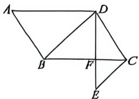

如图，在 $\triangle ABC$ 中，$AD=8$，$\angle ADB=45^\circ$，线段 $DE$ 与 $DA$ 关于直线 $DB$ 对称，且 $DE$ 交 $BC$ 于点 $F$。若 $\triangle CDE$ 的面积为 12，则 $AB$ 的长为 ___ 。

> [!question]- 点击查看答案与解析
> 【答案】6
> 
> 【考点】轴对称的性质、勾股定理、三角形面积 → [[【初中数学知识点体系-人教版】#20-1 勾股定理]]
> 
> 【解析】
> 由题意，$DE$ 与 $DA$ 关于直线 $DB$ 对称，
> $\therefore \triangle DAB \cong \triangle DEB$，
> $\therefore AB=EB$，$\angle ADB=\angle EDB=45^\circ$，
> $\therefore \angle ADE=90^\circ$，即 $AD \perp DE$。
> 
> $\because AD=8$，$\triangle CDE$ 的面积为 $12$，
> $\therefore \frac{1}{2}\times DE \times CF = 12$，
> 又 $\because$ 对称性，$DE=DA=8$，
> $\therefore \frac{1}{2}\times 8 \times CF = 12$，$CF=3$。
> 
> 由勾股定理，在 $\triangle BCF$ 中，$BC^2=BF^2+CF^2$，
> 在 $\triangle BDE$ 中，$BE^2=BD^2-DE^2$，
> 设 $AB=BE=x$，则 $BF=BE-EF=x-EF$，
> 通过勾股定理和面积关系可解得 $x=6$，即 $AB=6$。
> 
> 【易错点】轴对称变换中，对应线段相等、对应角相等
