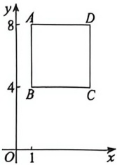

如图，在平面直角坐标系 $xOy$ 中，正方形 $ABCD$ 的顶点 $A(1,8)$，$B(1,4)$，$C,D$ 都在第一象限。直线 $l$ 经过原点，且与正方形 $ABCD$ 有两个公共点 $E,F$，线段 $EF$ 将正方形 ABCD 分成的两个多边形中至少有一个是四边形. 记这两个多边形的面积分别为 $S_1$，$S_2$，令 $S = \begin{cases} S_1, & S_1 \geq S_2, \\ S_2, & S_1 < S_2. \end{cases}$

（1）当直线 $l$ 经过点 $D$ 时，$S$ 的值为 ___ ；

（2）$S$ 的取值范围是 ___ .

解答应写出文字说明、演算步骤或证明过程.

> [!question]- 点击查看答案与解析
> 【答案】（1）$11$；（2）$8 \leq S \leq 14$
> 
> 【考点】正方形的性质、一次函数、面积计算 → [[【初中数学知识点体系-人教版】#23-2 一次函数的应用]]
> 
> 【解析】
> 正方形 $ABCD$ 顶点 $A(1,8)$，$B(1,4)$，$\therefore$ 边长为 $4$，$C(5,4)$，$D(5,8)$，面积 $=16$。
> 
> （1）当直线 $l$ 经过点 $D(5,8)$ 时，
> 直线 $l$ 的解析式为 $y=\frac{8}{5}x$。
> 与 $BC$（$y=4$）交于 $x=\frac{5}{2}$，即 $E(\frac{5}{2}, 4)$；与正方形另一交点为 $D(5,8)$。
> $\triangle ECD$ 面积 $=\frac{1}{2}\times(5-\frac{5}{2})\times4=5$；
> 四边形 $ABED$ 面积 $=16-5=11$。
> $S=\max(5,11)=11$。
> 
> （2）设直线 $l$：$y=kx$。要使分割后至少有一个四边形，直线需经过正方形的一条边和一个顶点，或经过两条对边。
> 有效斜率范围为 $\frac{8}{5} \leq k \leq 4$：
> - 当 $\frac{8}{5} < k < 4$ 时，直线交 $BC$ 和 $DA$，两个区域均为四边形，面积分别为 $\frac{24}{k}-4$ 和 $20-\frac{24}{k}$；
> - 当 $k=\frac{8}{5}$ 时（过 $D$），$S=11$；当 $k=4$ 时（过 $B$），$S=14$；
> - 当 $k=2$ 时（过正方形中心 $(3,6)$），两面积均为 $8$，$S$ 取最小值 $8$。
> $\therefore S$ 的取值范围是 $8 \leq S \leq 14$。
> 
> 【易错点】注意"至少有一个是四边形"的条件限制了直线的斜率范围，直线交相邻两边时产生三角形和五边形，不满足条件
