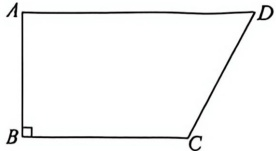

如图，在梯形 $ABCD$ 中，$AD \parallel BC$，$\angle B = 90^\circ$，$AD > BC > AB$。连接 $AC$，作线段 $AC$ 的垂直平分线交 $AD$ 于点 $E$，交 $AC$ 于点 $O$，交 $BC$ 于点 $F$，连接 $AF$，$CE$。

（1）使用直尺和圆规依题意补全图形（保留作图痕迹）；

（2）证明四边形 AFCE 是菱形的一种方法如下，请将证明过程补充完整.

证明：∵线段 AC 的垂直平分线 EF 交 AC 于点 O，

$\therefore AO=CO$

$\because AE\parallel FC$

$\therefore\angle AEO=\angle CFO,\angle EAO=\angle FCO$

$\therefore\triangle AEO\cong\triangle CFO$

$\therefore\_\_=\_\_$

∴四边形 AFCE 是平行四边形（ ___ ）（填推理的依据）

$\because EF\perp AC$

∴四边形 AFCE 是菱形（ ___ ）（填推理的依据）

（3）若 $AB=6$，$BC=8$，求菱形 $AFCE$ 的边长.

> [!question]- 点击查看答案与解析
> 【答案】（1）略；（2）$AE=CF$，一组对边平行且相等的四边形是平行四边形，对角线互相垂直的平行四边形是菱形；（3）菱形AFCE的边长为$\frac{25}{4}$
> 
> 【考点】菱形的判定与性质、垂直平分线的性质 → [[【初中数学知识点体系-人教版】#21-1 平行四边形]]
> 
> 【解析】
> （1）作图略。
> 
> （2）证明：$\because$ 线段 $AC$ 的垂直平分线 $EF$ 交 $AC$ 于点 $O$，
> $\therefore AO=CO$。
> $\because AE\parallel FC$，
> $\therefore \angle AEO=\angle CFO$，$\angle EAO=\angle FCO$，
> $\therefore \triangle AEO\cong\triangle CFO$（ASA），
> $\therefore AE=CF$，
> $\therefore$ 四边形 $AFCE$ 是平行四边形（一组对边平行且相等的四边形是平行四边形）。
> $\because EF\perp AC$，
> $\therefore$ 四边形 $AFCE$ 是菱形（对角线互相垂直的平行四边形是菱形）。
> 
> （3）$AB=6$，$BC=8$，梯形 $ABCD$ 中，$AD\parallel BC$，$\angle B=90^\circ$。
> 设菱形 $AFCE$ 的边长为 $x$，则 $AF=FC=CE=AE=x$。
> $BF=BC-FC=8-x$。
> 在 Rt$\triangle ABF$ 中，由勾股定理：
> $AF^2=AB^2+BF^2$，即 $x^2=6^2+(8-x)^2$，
> $x^2=36+64-16x+x^2$，
> $16x=100$，$x=\frac{25}{4}$。
> $\therefore$ 菱形 $AFCE$ 的边长为 $\frac{25}{4}$。
> 
> 【易错点】菱形判定：先证平行四边形，再证对角线垂直或一组邻边相等
