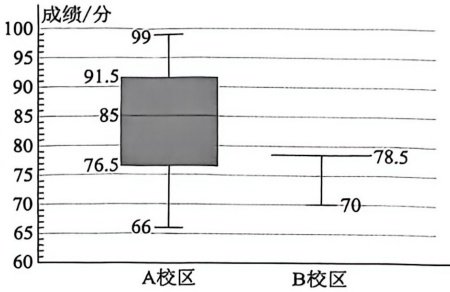

某校为促进学生养成健康生活习惯，组织该校 $A$，$B$ 两个校区的全体学生开展了青少年健康知识测试。为了解八年级学生对健康知识的掌握情况，从 $A$，$B$ 两个校区的八年级学生中各随机抽取了 20 名学生的成绩（百分制且为整数），并对数据进行整理、描述和分析，下面给出了部分信息。

表1

| 成绩x/分 | 人数 |
| --- | --- |
| 65\leq x<70 | 1 |
| 70\leq x<75 | 3 |
| 75\leq x<80 | 2 |
| 80\leq x<85 | 4 |
| 85\leq x<90 | m |
| 90\leq x<95 | 4 |
| 95\leq x<100 | 2 |

图1

a. 从 A 校区抽取的学生成绩如表 1 所示；

b. 从 B 校区抽取的学生成绩按由小到大顺序排列如下：

| 70 | 74 | 77 | 77 | 78 | 79 | 79 | 81 | 82 | 85 |
| --- | --- | --- | --- | --- | --- | --- | --- | --- | --- |
| 85 | 85 | 85 | 87 | 88 | 88 | 91 | 96 | 96 | 97 |

c. 从 A，B 两个校区抽取的学生成绩的箱线图如图 1（不完整）；

d. 从 A，B 两个校区抽取的学生成绩的平均数、中位数、众数如表 2:

表2

| 校区 | 平均数 | 中位数 | 众数 |
| --- | --- | --- | --- |
| A 校区 | 84 | n | 82 |
| B 校区 | 84 | 85 | p |

根据以上信息，回答下列问题：

（1）表1中 $m=$ ___ ；表2中 $n=$ ___ ，$p=$ ___ ；

（2）在图1中补全 B 校区的箱线图，并标注相关数据；

（3）已知从 A 校区抽取的学生成绩中某位学生的成绩是 90 分，请判断从 A 校区抽取的学生成绩中是否还有其他学生的成绩也是 90 分，并说明理由；

（4）已知 A，B 校区八年级各有 160 名学生，估计这两个校区八年级学生中成绩不低于 90 分的学生一共有多少人.

> [!question]- 点击查看答案与解析
> 【答案】（1）$m=4$，$n=83$，$p=85$；（2）略；（3）无法确定，因为频数分布表只给出 $90 \leq x < 95$ 组有4人，无法确定其中是否有多个90分；（4）80人
> 
> 【考点】频数分布表、箱线图、中位数、众数、用样本估计总体 → [[【初中数学知识点体系-人教版】#24-1 数据的集中趋势]]
> 
> 【解析】
> （1）从 A 校区抽取的 20 名学生成绩：
> $65\leq x<70$：1人，$70\leq x<75$：3人，$75\leq x<80$：2人，
> $80\leq x<85$：4人，$85\leq x<90$：$m$人，$90\leq x<95$：4人，$95\leq x<100$：2人。
> $1+3+2+4+m+4+2=20$，解得 $m=4$。
> 
> A 校区成绩从小到大排序，中位数为第10、11个数的平均数：
> 前 $1+3+2+4=10$ 人，第10个在 $80\leq x<85$ 组，第11个在 $85\leq x<90$ 组，
> $\therefore$ 中位数 $n=\frac{82+84}{2}=83$。
> 
> B 校区成绩：$70,74,77,77,78,79,79,81,82,85,85,85,85,87,88,88,91,96,96,97$，
> 众数 $p=85$（出现4次）。
> 
> （2）箱线图补全：B校区最小70，Q1=78，中位数85，Q3=88，最大97。
> 
> （3）无法确定。频数分布表中 $90 \leq x < 95$ 组有4人，已知其中一人成绩为90分，但其余3人的具体成绩未知（可能是90、91、92、93或94中的任意值），因此无法确定是否还有其他学生成绩也是90分。
> 
> （4）A 校区不低于90分的人数为 $4+2=6$ 人，占比 $\frac{6}{20}=30\%$；
> B 校区不低于90分的人数为 $91,96,96,97$ 共4人，占比 $\frac{4}{20}=20\%$。
> 估计 A 校区八年级 $160\times30\%=48$ 人，B 校区 $160\times20\%=32$ 人，
> 两个校区共 $48+32=80$ 人。
> 
> 【易错点】中位数不一定在数据中出现，众数一定是出现次数最多的数据值
