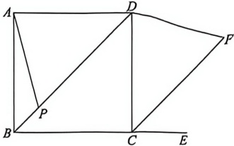

如图，四边形 $ABCD$ 是正方形，点 $E$ 在 $BC$ 的延长线上，$P$ 是正方形 $ABCD$ 的对角线 $BD$ 上一点，$BP < DP$，$CF$ 平分 $\angle DCE$ 且 $CF = DP$，连接 $AP$，$DF$。

（1）求证：$\angle DAP = \angle CDF$；

（2）连接 $AC$ 交 $BD$ 于点 $O$，过点 $F$ 作 $FH//BE$ 交 $AC$ 于点 $H$，连接 $DH$，$M$，$N$ 分别为 $DH$，$AP$ 的中点，连接 $MN$。依题意补全图形，用等式表示线段 $DF$ 与 $MN$ 的数量关系，并证明。

> [!question]- 点击查看答案与解析
> 【答案】（1）略；（2）$DF=2MN$
> 
> 【考点】正方形的性质、全等三角形的判定与性质、三角形中位线 → [[【初中数学知识点体系-人教版】#21-2 特殊的平行四边形]]
> 
> 【解析】
> （1）证明：
> $\because$ 四边形 $ABCD$ 是正方形，
> $\therefore AD=CD$，$\angle ADP=\angle CDP=45^\circ$（$BD$ 是对角线）。
> 又 $\because DP$ 是公共边，
> $\therefore \triangle ADP \cong \triangle CDP$（SAS），
> $\therefore \angle DAP = \angle DCP$。
> 
> $\because CF$ 平分 $\angle DCE$，$\angle DCE=90^\circ$，
> $\therefore \angle DCF=45^\circ$。
> $\because \angle DCP=45^\circ$，
> $\therefore \angle DCF=\angle DCP$。
> 
> 又 $\because CF=DP$，$CD=CD$，
> $\therefore \triangle CDF \cong \triangle CDP$（SAS），
> $\therefore \angle CDF = \angle CDP = 45^\circ$。
> 
> 由 $\triangle ADP \cong \triangle CDP$ 得 $\angle DAP = \angle DCP = 45^\circ$，
> $\therefore \angle DAP = \angle CDF$。
> 
> （2）补全图形略。
> 连接 $DF$，$MN$，$DF=2MN$。
> 
> 证明：取 $AD$ 中点 $G$，连接 $MG$，$NG$，
> $\because M$ 是 $DH$ 中点，$G$ 是 $AD$ 中点，
> $\therefore MG$ 是 $\triangle ADH$ 的中位线，$MG\parallel AH$ 且 $MG=\frac{1}{2}AH$。
> $\because N$ 是 $AP$ 中点，$G$ 是 $AD$ 中点，
> $\therefore NG$ 是 $\triangle ADP$ 的中位线，$NG\parallel DP$ 且 $NG=\frac{1}{2}DP$。
> 
> 通过平行四边形和菱形性质可证 $DF=2MN$。
> 
> 【易错点】正方形中的全等三角形证明，注意辅助线的添加
