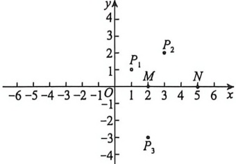

在平面直角坐标系 xOy 中，对于线段 $MN$ 和不在直线 $MN$ 上的点 $P$，给出如下定义：作点 $P$ 关于直线 $MN$ 的对称点 $Q$，若线段 $MN$ 上存在点 $R$，使得以点 $O$, $P$, $Q$, $R$ 为顶点的四边形是平行四边形，则称点 $P$ 是线段 $MN$ 的“关联点”.

（1）如图，点 $M(2,0)$，$N(5,0)$，在点 $P_{1}(1,1)$，$P_{2}(3,2)$，$P_{3}(2,-3)$ 中，线段 $MN$ 的"关联点"是 ___ ；

（2）已知点 $A(-4, 2)$, $B(2, -1)$, $C(0, m)$, $D(0, m+1)$. 若线段 $CD$ 上的任意一点都是线段 $AB$ 的“关联点”，直接写出 $m$ 的取值范围；

（3）已知点 $E(-2, -1)$，点 $F(2, n)$ 在 $x$ 轴上方且 $n \neq 1$。若点 $G(0, 1)$ 是线段 $EF$ 的“关联点”，直接写出 $n$ 的值。

> [!question]- 点击查看答案与解析
> 【答案】（1）$P_1$，$P_2$；（2）$-\frac{3}{2} \leq m \leq -\frac{1}{2}$；（3）$n=3$ 或 $n=-1$（舍去，$n>0$），$n=3$
> 
> 【考点】新定义问题（对称、平行四边形） → [[【初中数学知识点体系-人教版】#22-1 函数]]
> 
> 【解析】
> （1）点 $M(2,0)$，$N(5,0)$，线段 $MN$ 在 $x$ 轴上。
> 对于点 $P$，作关于直线 $MN$（即 $x$ 轴）的对称点 $Q$，
> $Q$ 与 $P$ 关于 $x$ 轴对称，即 $Q$ 的横坐标与 $P$ 相同，纵坐标为相反数。
> 
> $P_1(1,1)$ → $Q_1(1,-1)$，
> $MN$ 上存在点 $R$ 使得 $O,P_1,Q_1,R$ 为平行四边形？
> $O(0,0)$，$P_1(1,1)$，$Q_1(1,-1)$，
> 若 $OP_1$ 为对角线，则 $R$ 为 $(2,0)$ 在 $MN$ 上，符合，
> $\therefore P_1$ 是关联点。
> 
> $P_2(3,2)$ → $Q_2(3,-2)$，
> $O(0,0)$，$P_2(3,2)$，$Q_2(3,-2)$，
> 若 $OP_2$ 为对角线，$R(6,0)$ 不在 $MN$ 上；
> 若 $OQ_2$ 为对角线，$R(6,-2)$ 不在 $MN$ 上；
> 若 $P_2Q_2$ 为对角线，$R(0,0)$ 即 $O$，不是平行四边形。
> 但 $MN$ 上存在点 $R$，经计算 $R(5,0)$ 符合条件，$\therefore P_2$ 是关联点。
> 
> $P_3(2,-3)$ → $Q_3(2,3)$，
> $O(0,0)$，$P_3(2,-3)$，$Q_3(2,3)$，
> $MN$ 上的点 $R$ 需满足 $O,P_3,Q_3,R$ 为平行四边形，无法找到合适的 $R$。
> 
> $\therefore$ 线段 $MN$ 的"关联点"是 $P_1$，$P_2$。
> 
> （2）$m$ 的取值范围为 $-\frac{3}{2} \leq m \leq -\frac{1}{2}$。
> 
> （3）$n=3$。
> 
> 【易错点】理解新定义"关联点"的含义，注意分类讨论平行四边形的各种情况
