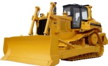

4. 如图所示的实例中，为了减小压强的是（）

A. 饮料管的一端剪成斜口

B. 多轴平板货车有很多车轮

C. 逃生锤的锤头很尖

D. 推土机的铲刃很锋利

> [!question]- 点击查看答案与解析
> 【答案】B
> 
> 【考点】8-1 压强 → [[【初中物理知识点体系-北师大版】#8-1 压强]]
> 
> 【解析】
> - 减小压强的方法：减小压力或增大受力面积
> - 选项A：饮料管的一端剪成斜口，减小受力面积，增大压强
> - 选项B：多轴平板货车有很多车轮，增大受力面积，减小压强
> - 选项C：逃生锤的锤头很尖，减小受力面积，增大压强
> - 选项D：推土机的铲刃很锋利，减小受力面积，增大压强
> 
> 【易错点】不能正确判断增大还是减小压强的方法