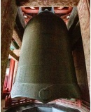

5. 如图所示的是被誉为“古钟之王”的永乐大钟。用大小不同的力撞击钟的同一位置使其发声，改变了大钟发出声音的（）

A. 响度

B. 音调

C. 音色

D. 频率

> [!question]- 点击查看答案与解析
> 【答案】A
> 
> 【考点】3-2 声音的特性 → [[【初中物理知识点体系-北师大版】#3-2 声音的特性]]
> 
> 【解析】
> - 声音的三个特性：响度、音调、音色
> - 响度与振幅有关，振幅越大，响度越大
> - 音调与频率有关，频率越高，音调越高
> - 音色与发声体的材料和结构有关
> - 用大小不同的力撞击钟的同一位置，改变了振幅，从而改变了响度
> 
> 【易错点】混淆响度、音调、音色的影响因素