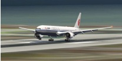

7. 如图所示，飞机着陆后在水平跑道上减速滑行。下列说法正确的是（）

A. 飞机受到的重力和飞机对跑道的压力是一对平衡力

B. 飞机对跑道的压力和跑道对飞机的支持力是一对相互作用力

C. 飞机在跑道上减速滑行是由于飞机失去了惯性

D. 飞机在跑道上减速滑行的过程中不再受到力的作用

> [!question]- 点击查看答案与解析
> 【答案】B
> 
> 【考点】7-5 二力平衡 → [[【初中物理知识点体系-北师大版】#7-5 二力平衡]]
> 
> 【解析】
> - 平衡力：作用在同一物体上，大小相等、方向相反、作用在同一直线上
> - 相互作用力：作用在两个物体上，大小相等、方向相反、作用在同一直线上
> - 选项A：飞机受到的重力和飞机对跑道的压力，方向相同，不是平衡力
> - 选项B：飞机对跑道的压力和跑道对飞机的支持力，是一对相互作用力，正确
> - 选项C：惯性是物体保持原来运动状态的性质，不能说"失去惯性"
> - 选项D：飞机减速滑行，一定受到力的作用
> 
> 【易错点】混淆平衡力和相互作用力，对惯性概念理解不清