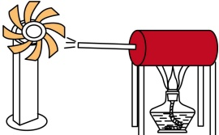

8. 如图所示，易拉罐中装有适量的水，用酒精灯加热，当有蒸汽喷出时，风车的扇叶就转动起来。下列说法正确的是（）

A. 易拉罐中水的内能增加是通过做功的方式实现的

B. 酒精灯内的酒精减少会导致酒精的热值变小

C. 推动扇叶转动的水蒸气的内能减小

D. 推动扇叶转动的水蒸气的内能全部转化为扇叶的机械能

> [!question]- 点击查看答案与解析
> 【答案】C
> 
> 【考点】10-2 内能 → [[【初中物理知识点体系-北师大版】#10-2 内能]]
> 
> 【解析】
> - 改变内能的方式：做功和热传递
> - 选项A：易拉罐中水的内能增加是通过热传递的方式实现的，不是做功
> - 选项B：热值是燃料的特性，与质量无关，酒精减少不会改变热值
> - 选项C：推动扇叶转动的水蒸气对外做功，内能减小，正确
> - 选项D：水蒸气的内能不可能全部转化为扇叶的机械能，有能量损失
> 
> 【易错点】混淆改变内能的两种方式，对能量转化理解不清