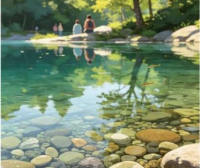

9. 某游客在景区看到如图所示的情景，下列说法正确的是（）

A. 树在水中的倒影是由光的折射形成的

B. 游客看到的水中鹅卵石的位置比它的实际位置浅

C. 树在水中的倒影是实像

D. 游客看到的水中的“鱼”是实像

> [!question]- 点击查看答案与解析
> 【答案】B
> 
> 【考点】4-3 平面镜成像 → [[【初中物理知识点体系-北师大版】#4-3 平面镜成像]]
> 
> 【解析】
> - 平面镜成像特点：正立、等大的虚像，像与物关于镜面对称
> - 光的折射：光从一种介质斜射入另一种介质时，传播方向发生改变
> - 选项A：树在水中的倒影是平面镜成像，属于光的反射现象
> - 选项B：游客看到的水中鹅卵石的位置比它的实际位置浅，是光的折射现象，正确
> - 选项C：树在水中的倒影是虚像，不是实像
> - 选项D：游客看到的水中的"鱼"是虚像，不是实像
> 
> 【易错点】混淆光的反射和折射现象，混淆实像和虚像