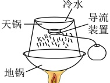

10. “天锅蒸馏法”是中国固态发酵蒸馏酒的标志性技艺，其工作过程示意如图。酿酒原料在地锅中被加热，产生含有酒精蒸气的热汽。含有酒精蒸气的热汽上升遇到内盛冷水的天锅底部形成液态酒，落入导流装置流出。关于该过程，下列说法正确的是（）

A. 酿酒原料中的液态酒精变成酒精蒸气是升华现象

B. 酒精蒸气形成液态酒精是汽化现象

C. 酒精蒸气形成液态酒精的过程中会放出热量

D. 天锅中冷水的温度保持不变

> [!question]- 点击查看答案与解析
> 【答案】C
> 
> 【考点】1-3 汽化和液化 → [[【初中物理知识点体系-北师大版】#1-3 汽化和液化]]
> 
> 【解析】
> - 汽化：物质从液态变为气态，吸热
> - 液化：物质从气态变为液态，放热
> - 升华：物质从固态直接变为气态，吸热
> - 选项A：液态酒精变成酒精蒸气是汽化现象，不是升华
> - 选项B：酒精蒸气形成液态酒精是液化现象，不是汽化
> - 选项C：酒精蒸气形成液态酒精是液化过程，会放出热量，正确
> - 选项D：天锅中冷水吸收热量，温度会升高
> 
> 【易错点】混淆汽化、液化、升华等物态变化