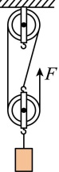

11. 如图所示，用滑轮组提升重为810N的重物，绳子自由端在拉力F的作用下竖直匀速上升了9m，用时30s，F为300N。动滑轮重80N。下列说法正确的是（）

A. 重物上升的速度为0.3m/s

B. 拉力F的功率为81W

C. 滑轮组的额外功为240J

D. 滑轮组的机械效率为90%

> [!question]- 点击查看答案与解析
> 【答案】D
> 
> 【考点】9-2 滑轮 → [[【初中物理知识点体系-北师大版】#9-2 滑轮]]
> 
> 【解析】
> - 滑轮组：$s=nh$，$F=\frac{1}{n}(G_{物}+G_{动})$
> - 由图可知，承担物重的绳子段数 $n=3$
> - 选项A：重物上升的高度 $h=\frac{s}{n}=\frac{9m}{3}=3m$，速度 $v=\frac{h}{t}=\frac{3m}{30s}=0.1m/s$
> - 选项B：拉力F的功率 $P=\frac{W}{t}=\frac{Fs}{t}=\frac{300N\times9m}{30s}=90W$
> - 选项C：有用功 $W_{有}=Gh=810N\times3m=2430J$，总功 $W_{总}=Fs=300N\times9m=2700J$，额外功 $W_{额}=W_{总}-W_{有}=270J$
> - 选项D：机械效率 $\eta=\frac{W_{有}}{W_{总}}=\frac{2430J}{2700J}=90\%$，正确
> 
> 【易错点】滑轮组公式应用错误，计算粗心