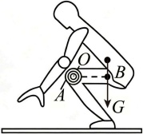

12. 图甲所示的是机器人在水平地面上抓取物体时双腿并拢下蹲的姿态，其示意图如图乙所示，机器人的膝关节可视为一个圆柱体，O为其轴线上一点。电动机对两膝关节的动力可等效为作用在两膝关节之间A点的一个竖直方向的力，机器人的膝关节、大腿及上半身总重G为270N，重力G的作用线通过AO延长线上的B点，AOB与地面平行。此时可将机器人的膝关节、大腿及上半身看成杠杆，如图丙所示。已知机器人总重为360N，大腿长度为40cm，膝关节半径AO为4cm，OB的长度为大腿长度的 $\frac{2}{3}$，每只脚与地面的接触面积为150cm²。下列关于机器人静止在此姿态下的说法正确的是（）

甲

乙

丙

A. 机器人对地面的压强为 $2.4\times10^{4}$ Pa

B. 机器人膝关节、大腿及上半身可视为省力杠杆

C. 电动机作用在 $A$ 点的力是竖直向上的

D. 电动机作用在 $A$ 点的力为 $1800\text{N}$

> [!question]- 点击查看答案与解析
> 【答案】A
> 
> 【考点】8-1 压强 → [[【初中物理知识点体系-北师大版】#8-1 压强]]
> 
> 【解析】
> - 压强公式：$p=\frac{F}{S}$
> - 机器人对地面的压力 $F=G_{总}=360N$
> - 两只脚与地面的总接触面积 $S=2\times150cm^2=300cm^2=0.03m^2$
> - 机器人对地面的压强 $p=\frac{F}{S}=\frac{360N}{0.03m^2}=1.2\times10^4Pa$
> - 选项A：计算错误，应为 $1.2\times10^4Pa$
> - 选项B：需要分析杠杆的五要素才能判断
> - 选项C：需要分析杠杆平衡条件
> - 选项D：需要应用杠杆平衡条件计算
> 
> 【易错点】压强公式应用错误，单位换算错误