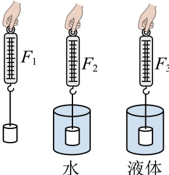

14. 如图所示，重物挂在弹簧测力计下静止时，弹簧测力计示数为 $F_1$；再分别将其浸没在水和密度为 $\rho$ 的液体中静止时，弹簧测力计的示数分别为 $F_2$、$F_3$。已知水的密度为 $\rho_{\text{水}}$。下列说法正确的是（）

A. 重物在水中受到的浮力为 $F_{1}-F_{2}$

B. 重物在水中时，水对重物的压力的合力为 $F_{2}$

C. 若 $F_{3}<F_{2}$，则液体的密度 $\rho<\rho_{水}$

D. 液体的密度 $\rho=\frac{(F_{1}-F_{3})\rho_{水}}{F_{1}-F_{2}}$

> [!question]- 点击查看答案与解析
> 【答案】AD
> 
> 【考点】8-5 浮力 → [[【初中物理知识点体系-北师大版】#8-5 浮力]]
> 
> 【解析】
> - 浮力公式：$F_{浮}=G-F_{示}$
> - 选项A：重物在水中受到的浮力 $F_{浮}=F_1-F_2$，正确
> - 选项B：重物在水中时，水对重物的压力的合力等于浮力，即 $F_1-F_2$，不是 $F_2$
> - 选项C：若 $F_3<F_2$，说明在液体中受到的浮力更大，液体密度更大，$\rho>\rho_{水}$
> - 选项D：由 $F_1-F_2=\rho_{水}gV$ 和 $F_1-F_3=\rho gV$，得 $\rho=\frac{(F_1-F_3)\rho_{水}}{F_1-F_2}$，正确
> 
> 【易错点】浮力公式应用错误，对浮力产生的原因理解不清