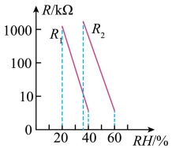
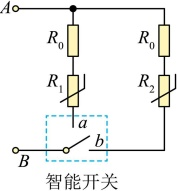

15. 湿敏电阻可以感知环境湿度（湿度是衡量空气干湿程度的常用指标，符号为RH，通常用百分数表示），图甲为两个湿敏电阻 $R_{1}$ 和 $R_{2}$ 的阻值随湿度变化的关系图像。$R_{1}$ 的感湿范围为20%到40%，$R_{2}$ 的感湿范围为36%到60%，当低于感湿范围下限时湿敏电阻相当于绝缘体，当超过感湿范围上限时湿敏电阻保持感湿上限的阻值不变。某科技小组设计了如图乙所示的测量湿度的电路，AB间电压恒定，$R_{0}$ 为定值电阻，智能开关初始状态接a且能根据电流大小自动控制电路，使电阻 $R_{1}$、$R_{2}$ 能分别参与测量，从而实现电路在湿度20%到60%范围内连续测量。开关接a状态下，当电流小于 $I_{1}$ 时开关保持与a连接，当电流大于或等于 $I_{1}$ 时开关自动由a转向b。开关接b状态下，当电流大于 $I_{2}$ 时开关保持与b连接，当电流减小至 $I_{2}$ 时开关自动由b转向a。下列说法正确的是（）

甲

乙

A. 电路中流过A的电流越大，则湿度越大

B. 湿度为25%时对应的电流小于湿度为30%时对应的电流

C. $I_{1}$ 所对应的湿度大于 $I_{2}$ 所对应的湿度

D. 若湿度在 $I_{1}$ 和 $I_{2}$ 所对应的湿度之间，开关可能接a，也可能接b

> [!question]- 点击查看答案与解析
> 【答案】CD
> 
> 【考点】12-2 欧姆定律 → [[【初中物理知识点体系-北师大版】#12-2 欧姆定律]]
> 
> 【解析】
> - 根据题意分析湿敏电阻的特性和电路工作原理
> - 选项A：电路中流过A的电流与湿度的关系需要结合湿敏电阻的特性分析
> - 选项B：湿度为25%时，$R_1$ 在工作范围内，$R_2$ 低于下限，相当于绝缘体
> - 选项C：$I_1$ 对应的是 $R_1$ 的上限阻值，$I_2$ 对应的是 $R_2$ 的上限阻值，分析可得 $I_1$ 对应的湿度大于 $I_2$
> - 选项D：若湿度在 $I_1$ 和 $I_2$ 所对应的湿度之间，开关可能接a，也可能接b
> 
> 【易错点】对湿敏电阻的特性理解不清，电路分析复杂