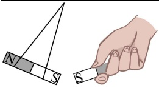
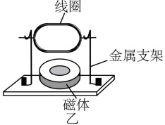

16. (1) 如图甲所示，把一根条形磁体悬挂起来，用另一根条形磁体接近它，可以观察到的现象是 ___ 。

甲

(2) 如图乙所示，将两个金属支架分别与电池的两极相连，给线圈通电，观察到线圈转动起来，这就是一个简易电动机，其工作原理是 ___ 。

乙

> [!question]- 点击查看答案与解析
> 【答案】(1) 同名磁极相互排斥，异名磁极相互吸引；(2) 通电线圈在磁场中受力转动
> 
> 【考点】15-1 磁现象 磁场 → [[【初中物理知识点体系-北师大版】#15-1 磁现象 磁场]]
> 
> 【解析】
> - (1) 磁极间的相互作用规律：同名磁极相互排斥，异名磁极相互吸引
> - (2) 电动机的工作原理：通电线圈在磁场中受力转动
> 
> 【易错点】对磁极间相互作用规律和电动机原理记忆不牢