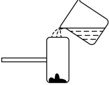
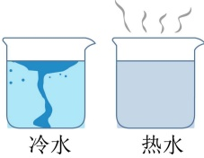

17. (1) 如图甲所示，封闭的玻璃容器中有少量碘颗粒，向容器浇热水，可以观察到容器中充满紫色的碘蒸气，碘发生的物态变化是 ___ 。

甲

(2)在冷水和热水中同时各滴入一滴蓝墨水，过一段时间，观察到蓝墨水在热水中比在冷水中扩散得快（如图乙所示），该实验说明 ___ 。

**乙**

> [!question]- 点击查看答案与解析
> 【答案】(1) 升华；(2) 温度越高，分子运动越剧烈
> 
> 【考点】1-4 升华和凝华 → [[【初中物理知识点体系-北师大版】#1-4 升华和凝华]]
> 
> 【解析】
> - (1) 碘颗粒向热水浇，直接变成碘蒸气，是升华现象
> - (2) 蓝墨水在热水中扩散得快，说明温度越高，分子运动越剧烈
> 
> 【易错点】混淆升华和汽化，对分子热运动理解不清