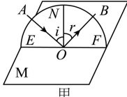
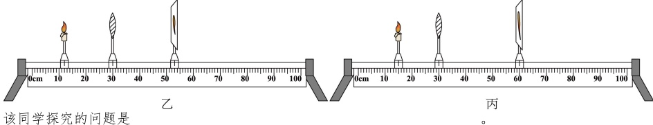

18. (1) 某同学用图甲所示的装置探究光在反射时反射角与入射角的关系，使一束光贴着纸板EF沿某一个角度射到O点，经平面镜M反射，沿另一个方向射出。在纸板上用笔描出入射光AO和反射光OB。改变光束入射的角度，重复实验。测量入射角 $\angle i$ 和反射角 $\angle r$ 的数据记录在下表中。

甲

| 入射角 $i$ | $70^{\circ}$ | $60^{\circ}$ | $50^{\circ}$ | $40^{\circ}$ | $30^{\circ}$ | $20^{\circ}$ |
|---|---|---|---|---|---|---|
| 反射角 $r$ | $70^{\circ}$ | $60^{\circ}$ | $50^{\circ}$ | $40^{\circ}$ | $30^{\circ}$ | $20^{\circ}$ |

实验结论是 ___ 。

(2) 某同学利用同一凸透镜做了两次实验，蜡烛、透镜、光屏所在位置以及光屏上得到清晰像的情况如图乙、丙所示，并据此得出相应的结论。

该同学探究的问题是 ___ 。

> [!question]- 点击查看答案与解析
> 【答案】(1) 反射角等于入射角；(2) 凸透镜成像的规律
> 
> 【考点】4-2 光的反射 → [[【初中物理知识点体系-北师大版】#4-2 光的反射]]
> 
> 【解析】
> - (1) 根据表中数据，反射角始终等于入射角
> - (2) 探究的是凸透镜成像的规律
> 
> 【易错点】对光的反射定律和凸透镜成像规律掌握不牢