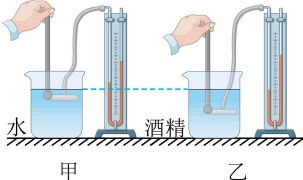

20. 实验桌上有两个相同的烧杯，分别盛有水和酒精，某同学利用微小压强计和刻度尺探究液体内部压强与液体密度是否有关。

(1) 实验中液体内部压强是通过微小压强计反映的。

(2) 他将微小压强计的探头分别放在水和酒精中进行实验，由图甲、乙得出结论“液体内部压强与液体密度有关”。

该同学在探究过程中存在的问题是 ___ 。

> [!question]- 点击查看答案与解析
> 【答案】没有控制探头在液体中的深度相同
> 
> 【考点】8-2 液体的压强 → [[【初中物理知识点体系-北师大版】#8-2 液体的压强]]
> 
> 【解析】
> - 探究液体内部压强与液体密度的关系时，需要控制探头在液体中的深度相同，只改变液体种类
> - 该同学的问题是没有控制变量（深度）
> 
> 【易错点】对控制变量法理解不清