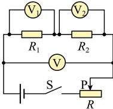

21. 某同学利用如图所示的电路探究在串联电路中，$R_{1}$、$R_{2}$ 两端的总电压 $U$ 与 $R_{1}$ 两端电压 $U_{1}$、$R_{2}$ 两端电压 $U_{2}$ 之间的关系。实验数据如下表所示。

| $U_1/V$ | 0.8 | 0.9 | 1.0 | 1.2 | 1.4 | 1.6 |
|---|---|---|---|---|---|---|
| $U_2/V$ | 0.4 | 0.4 | 0.5 | 0.6 | 0.7 | 0.8 |
| $I/V$ | 1.2 | 1.3 | 1.5 | 1.8 | 2.1 | 2.4 |

(1) 该实验中滑动变阻器起到的作用一方面是保护电路，另一方面是 ___ ；

(2) 进一步分析表中数据 $U$ 与 $U_{1}$、$U_{2}$ 之和的关系，得到的实验结论是 ___ 。

> [!question]- 点击查看答案与解析
> 【答案】(1) 改变电路中的电流和电压，进行多次测量；(2) $U=U_1+U_2$
> 
> 【考点】11-2 认识电路 → [[【初中物理知识点体系-北师大版】#11-2 认识电路]]
> 
> 【解析】
> - (1) 滑动变阻器的作用：保护电路，改变电路中的电流和电压，进行多次测量
> - (2) 分析表中数据，$U=U_1+U_2$，串联电路的总电压等于各部分电压之和
> 
> 【易错点】对滑动变阻器的作用和串联电路的电压规律掌握不牢