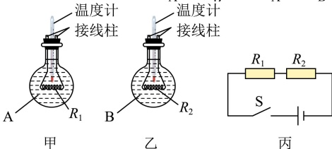

23. 若相同质量的不同物质，升高相同的温度，则可认为吸收热量较多的物质吸热性能较强。为了比较A、B两种液体的吸热性能，某同学在两个完全相同的烧瓶内分别装入质量相等的A和B两种液体、阻值不变的电阻丝 $(R_{1}<R_{2})$ 及温度计，如图甲、乙所示。将 $R_{1}$、$R_{2}$ 按图丙所示接入电路进行实验，闭合开关一段时间后，两液体均未沸腾，记录两种液体升高的温度 $\Delta T_{A}$ 和 $\Delta T_{B}$。若 $\Delta T_{A}>\Delta T_{B}$，不计热量损失，请分析判断哪种液体的吸热性能较强。

> [!question]- 点击查看答案与解析
> 【答案】B液体的吸热性能较强
> 
> 【考点】10-3 比热容 → [[【初中物理知识点体系-北师大版】#10-3 比热容]]
> 
> 【解析】
> - 根据题意，$R_1<R_2$，串联电路中电流相等，由 $Q=I^2Rt$ 可知，$R_2$ 产生的热量更多
> - 若 $\Delta T_A>\Delta T_B$，说明A液体升高的温度更多
> - 由于 $R_2$ 产生的热量更多，但B液体升高的温度更少，说明B液体的吸热性能更强
> 
> 【易错点】对吸热性能的理解不清，不能正确分析热量和温度变化的关系