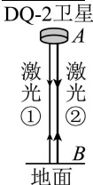

24. 阅读下面的材料，并依据材料回答问题。

“节能减排”的守护者——高精度温室气体综合探测卫星

2026年4月，我国成功发射高精度温室气体综合探测卫星（DQ-2），它是国际上首颗主被动协同高精度温室气体探测卫星，可实现对全球温室气体的大范围探测。

DQ-2卫星上搭载的大气探测激光雷达是主动探测的核心设备，其工作原理：激光雷达发出易与待测气体粒子发生明显相互作用的激光，并接收反射的回波信号，大气中待测气体浓度越高，相同路径下与激光发生相互作用的粒子数越多，回波信号的能量就越弱，这样就可以通过回波信号对该气体的浓度进行分析。

DQ-2卫星在对二氧化碳气体进行实际探测时，激光雷达需要同时发射能量近似相等的两束平行激光，其中一束激光与二氧化碳分子有明显相互作用，另一束激光与其无明显相互作用，并且这两束激光与除二氧化碳气体以外的大气粒子及地面相互作用效果相同。通过测量两束激光回波信号的能量比，并将它与两束激光发射时的能量比进行比较，可分析得到激光路径上的二氧化碳浓度。DQ-2卫星还可以通过测量两束激光在不同高度回波信号的时间信息，再结合能量信息最终获得不同高度大气中二氧化碳浓度的信息。

DQ-2卫星将服务于国家“碳达峰”和“碳中和”双碳国家战略，同时为全球环境监测、气候气象研究提供支撑。

(1) DQ-2卫星是国际上首颗主被动协同 ___ 温室气体探测卫星。

(2) 在获取不同高度大气中二氧化碳浓度信息的过程中，DQ-2 卫星通过测量回波信号的 ___ （选填“时间”或“能量比”）信息，从而获取回波信号返回位置的高度信息。

(3) 如图所示，DQ-2卫星第一次经过某地上空A位置时，发射能量近似相等的两束激光 $①$ 和 $②$，一段时间后接收到激光 $①$ 和 $②$ 由地面B位置反射的回波信号的能量分别为 $E_{1}$、$E_{2}$，且 $k=\frac{E_{1}}{E_{2}}$。卫星第二次经过该地上空A时，再次发射两束与第一次测量时相同的激光，接收到从B反射的回波信号的能量为 $E_{1}'$、$E_{2}'$，且 $k'=\frac{E_{1}^{\prime}}{E_{2}^{\prime}}$。已知 $k<1$，则激光 ___ （选填“$①$”或“$②$”）与二氧化碳分子有明显的相互作用，若 $k'>k$，则第二次测得的二氧化碳浓度 ___ （选填“高于”“等于”或“低于”）第一次测得的二氧化碳浓度。

> [!question]- 点击查看答案与解析
> 【答案】(1) 主被动协同；(2) 时间；(3) ①，高于
> 
> 【考点】16-3 能源：危机与希望 → [[【初中物理知识点体系-北师大版】#16-3 能源：危机与希望]]
> 
> 【解析】
> - (1) 根据材料，DQ-2是主被动协同高精度温室气体探测卫星
> - (2) 根据材料，通过测量回波信号的时间信息获取高度信息
> - (3) $k<1$ 说明 $E_1<E_2$，激光①与二氧化碳分子有明显相互作用；$k'>k$ 说明回波信号能量比增大，二氧化碳浓度高于第一次
> 
> 【易错点】对材料信息提取和分析能力不足