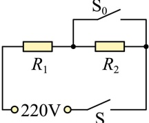

25. 某品牌电热饮水机具有加热和保温功能，其简化电路如图所示，其中 $S$ 为手动开关，$S_{0}$ 为自动温控开关。表中为该电热饮水机铭牌上的部分参数，求：

| 额定电压 | 220 V |
|---|---|
| 额定加热功率 | 1100 W |
| 额定保温功率 | 22 W |

(1) 电热饮水机处于额定保温状态时，电路中的电流；

(2) 电阻 $R_{2}$ 的阻值。

> [!question]- 点击查看答案与解析
> 【答案】(1) 0.1A；(2) 2156Ω
> 
> 【考点】13-2 电功率 → [[【初中物理知识点体系-北师大版】#13-2 电功率]]
> 
> 【解析】
> - (1) 保温状态时，$P_{保}=22W$，$U=220V$
>   $I=\frac{P_{保}}{U}=\frac{22W}{220V}=0.1A$
> - (2) 加热状态时，$P_{加}=1100W$
>   $R_1=\frac{U^2}{P_{加}}=\frac{(220V)^2}{1100W}=44\Omega$
>   保温状态时，$R_{总}=\frac{U}{I}=\frac{220V}{0.1A}=2200\Omega$
>   $R_2=R_{总}-R_1=2200\Omega-44\Omega=2156\Omega$
> 
> 【易错点】对电功率公式应用错误，不能正确分析电路的工作状态