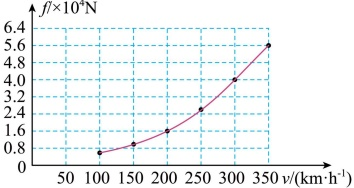

26. 我国的高铁规模雄踞世界第一，高铁技术处在世界最前沿。高铁运行的动力来源是电力系统提供的电能，列车消耗电能主要用于两部分：一是为电机提供动力，二是为车厢内各种用电器提供电能。列车运行时，会受到不同种类的阻力，其中空气阻力影响最大，车速越大，列车受到的空气阻力就越大，导致需要电机提供的牵引力越大，耗电越快。如图所示为某列车试验阶段所受空气阻力f随速度v变化的关系图像。该列车以350 km/h的速度在水平直轨道上做匀速直线运动，所受空气阻力占总阻力的80%，忽略车厢内用电器的耗电。

(1) 求列车受到的总阻力的大小；

(2) 求列车运行 $1 \, h$ 电机牵引力做的功；

(3) 已知该列车电机将电能转化为机械能的效率为94%，若该列车仍以 350km/h 的速度在水平直轨道上做匀速直线运动，但受到的总阻力减小 5%，求列车运行 1h 能节省的电能。

> [!question]- 点击查看答案与解析
> 【答案】(1) $1.25\times10^5N$；(2) $4.375\times10^{10}J$；(3) $7.5\times10^8J$
> 
> 【考点】9-4 功率 → [[【初中物理知识点体系-北师大版】#9-4 功率]]
> 
> 【解析】
> - (1) 由图像可知，$v=350km/h$ 时，空气阻力 $f=1\times10^5N$
>   总阻力 $F_{阻}=\frac{f}{80\%}=\frac{1\times10^5N}{0.8}=1.25\times10^5N$
> - (2) 匀速直线运动，牵引力 $F=F_{阻}=1.25\times10^5N$
>   $s=vt=350km/h\times1h=350km=3.5\times10^5m$
>   $W=Fs=1.25\times10^5N\times3.5\times10^5m=4.375\times10^{10}J$
> - (3) 阻力减小5%，$F'_{阻}=0.95\times1.25\times10^5N=1.1875\times10^5N$
>   节省的功 $\Delta W=(F-F')s=(1.25\times10^5N-1.1875\times10^5N)\times3.5\times10^5m=2.1875\times10^9J$
>   节省的电能 $\Delta E=\frac{\Delta W}{\eta}=\frac{2.1875\times10^9J}{0.94}\approx2.33\times10^9J$
> 
> 【易错点】对功率和功的公式应用错误，单位换算错误，效率计算错误