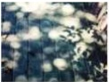
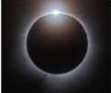
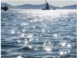

1. （2分）如图所示的四个情景中，属于光的反射现象的是（ ）

A. 树荫下的圆形光斑

B. 日食的形成

C. 林中树的影子

D. 水面波光粼粼

> [!question]- 点击查看答案与解析
> 【答案】D
> 
> 【考点】光的反射 → [[【初中物理知识点体系-北师大版】#4-2 光的反射]]
> 
> 【解析】
> - 选项A：树荫下的圆形光斑是小孔成像现象，属于光的直线传播，错误；
> - 选项B：日食的形成是月球挡住了太阳射向地球的光，属于光的直线传播，错误；
> - 选项C：林中树的影子是由于光沿直线传播时被树挡住形成的，属于光的直线传播，错误；
> - 选项D：水面波光粼粼是光在水面发生反射形成的，属于光的反射现象，正确。
> 
> 【易错点】混淆光的直线传播、反射、折射现象。