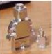

7. （2分）如图甲，用金属镓制成的“小人”在室温为 $20^{\circ}\mathrm{C}$ 时是固态，当其达到某一温度时，就会发生熔化。图乙是其放在人手中熔化时的情景，由此可判断（ ）

甲

乙

A. 镓是非晶体

B. 镓的熔点可能是 $29^{\circ}\mathrm{C}$

C. 可用镓制成的锅烧开水

D. 镓熔化的过程中，放出热量

> [!question]- 点击查看答案与解析
> 【答案】B
> 
> 【考点】熔化和凝固 → [[【初中物理知识点体系-北师大版】#1-2 熔化和凝固]]
> 
> 【解析】
> 由图可知，镓在室温 $20^{\circ}\mathrm{C}$ 时是固态，放在人手中会熔化，说明手的温度高于镓的熔点。
> - 选项A：镓有固定的熔点，是晶体，错误；
> - 选项B：镓在室温下是固态，在手中能熔化，说明熔点高于 $20^{\circ}\mathrm{C}$，低于手的温度（约 $37^{\circ}\mathrm{C}$），所以熔点可能是 $29^{\circ}\mathrm{C}$，正确；
> - 选项C：烧开水温度为 $100^{\circ}\mathrm{C}$，高于镓的熔点，镓锅会熔化，错误；
> - 选项D：镓熔化过程中吸收热量，错误。
> 
> 【易错点】混淆晶体与非晶体的熔化特点。