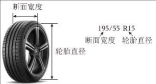

8. （2分）如图所示是某型号小汽车的车轮及其规格型号尺寸数据“195/55R 5……”，其中“15”表示轮毂直径为15英寸，车轮的断面宽“195”的单位应当是（ ）

A. $m$

B. $dm$

C. $cm$

D. $mm$

> [!question]- 点击查看答案与解析
> 【答案】D
> 
> 【考点】长度和时间的测量 → [[【初中物理知识点体系-北师大版】#2-1 长度和时间的测量]]
> 
> 【解析】
> 195/55R 15 中，195表示轮胎断面宽度。汽车轮胎断面宽度一般在 $155\sim315\,\mathrm{mm}$ 之间，所以195的单位应该是 $\mathrm{mm}$。
> - 选项A：$195\,\mathrm{m}$ 显然太大，错误；
> - 选项B：$195\,\mathrm{dm}=19.5\,\mathrm{m}$，仍然太大，错误；
> - 选项C：$195\,\mathrm{cm}=1.95\,\mathrm{m}$，还是太大，错误；
> - 选项D：$195\,\mathrm{mm}=19.5\,\mathrm{cm}$，符合实际，正确。
> 
> 【易错点】对常见物理量的单位估计不准确。