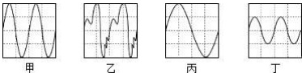

9. （2分）如图所示声波的波形图，下列说法正确的是（ ）

A. 甲、乙的音色相同

B. 甲、丙的音调相同

C. 乙、丙的响度相同

D. 丙、丁的音调和响度都相同

> [!question]- 点击查看答案与解析
> 【答案】C
> 
> 【考点】声音的特性 → [[【初中物理知识点体系-北师大版】#3-2 声音的特性]]
> 
> 【解析】
> 从波形图分析：
> - 选项A：甲、乙的波形形状不同，音色不同，错误；
> - 选项B：甲、丙的波形疏密不同，频率不同，音调不同，错误；
> - 选项C：乙、丙的波形振幅相同，响度相同，正确；
> - 选项D：丙、丁的波形疏密和振幅都不同，音调和响度都不同，错误。
> 
> 【易错点】混淆音调、响度、音色在波形图中的表现。