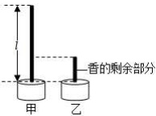

11. （2分）古时候通常会用“一炷香”作为计时单位，一炷质地均匀的香匀速燃烧完毕的时间通常约半个时辰，即1小时。如图甲是一炷长为 $t$ 刚点燃的香，如图乙是此炷香燃烧一段时间后的剩余部分。则图乙中的香燃尽还需要的时间最接近（ ）

A. $1800\,\mathrm{s}$

B. $1200\,\mathrm{s}$

C. $600\,\mathrm{s}$

D. $300\,\mathrm{s}$

> [!question]- 点击查看答案与解析
> 【答案】C
> 
> 【考点】长度和时间的测量 → [[【初中物理知识点体系-北师大版】#2-1 长度和时间的测量]]
> 
> 【解析】
> 一炷香燃烧完需要1小时 $=3600\,\mathrm{s}$。从图乙可以看出，剩余的香约为原来长度的一半多一点，所以燃尽还需要的时间约为总时间的一半，即约 $1800\,\mathrm{s}$ 或更少。
> - 选项A：$1800\,\mathrm{s}$ 是剩余时间的一半，但图中剩余香明显少于一半，错误；
> - 选项B：$1200\,\mathrm{s}$ 仍然偏大，错误；
> - 选项C：$600\,\mathrm{s}$ 最接近实际情况，正确；
> - 选项D：根据图示估算，错误。
> 
> 【易错点】对时间单位的换算和估算不准确。