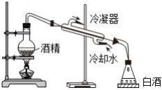

13. （2分）蒸馏法在酿酒过程中得到广泛应用，如图所示为蒸馏过程中的原理图，烧瓶内装有含酒精和水的酒糟，酒糟经过该装置后变为酒精含量更高的白酒，已知一标准大气压下，酒精沸点比水低。在蒸馏过程中，下列说法正确的是（ ）

A. 在烧瓶内，酒精沸腾，瓶中的酒精升华需要吸热

B. 在烧瓶内，仅酒精沸腾，瓶中的水不会发生汽化

C. 在冷凝器处，管内酒精蒸汽遇冷液化，需要放热

D. 在冷凝器处，管外的冷却水对管内的酒精蒸汽放热

> [!question]- 点击查看答案与解析
> 【答案】C
> 
> 【考点】汽化和液化 → [[【初中物理知识点体系-北师大版】#1-3 汽化和液化]]
> 
> 【解析】
> 已知酒精沸点比水低。
> - 选项A：在烧瓶内，酒精沸腾，是汽化现象，不是升华，错误；
> - 选项B：在烧瓶内，酒精和水都会发生汽化，错误；
> - 选项C：在冷凝器处，管内酒精蒸汽遇冷液化，需要放热，正确；
> - 选项D：在冷凝器处，管外的冷却水对管内的酒精蒸汽吸热，而不是放热，错误。
> 
> 【易错点】混淆汽化、液化的吸放热特点。