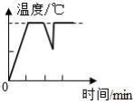
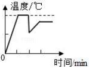
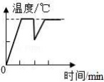
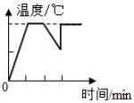

14. （2分）周末，小华在家中烧开水煮饺子。当水烧开准备下饺子时，妈妈提醒她锅里的水量太少了，于是，小华又往锅里迅速加了一大碗冷水（水量比锅里的少）。下面最能大致反映整个烧水过程中水温随着时间变化的图象是（ ）

A.

B.

C.

D.

> [!question]- 点击查看答案与解析
> 【答案】C
> 
> 【考点】汽化和液化 → [[【初中物理知识点体系-北师大版】#1-3 汽化和液化]]
> 
> 【解析】
> 烧水过程分析：先加热至沸腾，温度升高；加入冷水后，温度降低；继续加热，温度再次升高至沸腾。
> - 选项A：图像显示温度持续升高，不符合加水后温度降低的情况，错误；
> - 选项B：图像显示温度先升高后降低，但没有再次沸腾的过程，错误；
> - 选项C：图像显示温度先升高至沸点，加入冷水后温度下降，再加热至沸点，正确；
> - 选项D：图像显示温度先升高后保持不变，不符合加水后的情况，错误。
> 
> 【易错点】不能正确分析温度-时间图像中各阶段的物态变化。