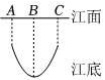
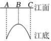
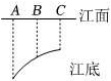
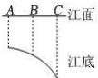

15. （2分）探测队利用声呐测绘某江域水底的形状，探测队驾驶船只经过该江城水平面的A、B、C三个位置时，向水底定向发射超声波，仪器记录从发出声音到接收到回声的时间 $t$ 如表所示。由此推测A、B、C三个位置下水底的大致形状是（ ）

| 采样位置 | A | B | C |
|------|------|------|------|
| 时间 $t/s$ | 0.30 | 0.16 | 0.30 |

A.

B.

C.

D.

> [!question]- 点击查看答案与解析
> 【答案】B
> 
> 【考点】运动的快慢 → [[【初中物理知识点体系-北师大版】#2-3 运动的快慢]]
> 
> 【解析】
> 声呐发射超声波，根据回声时间判断水深。
> - A位置：$t=0.30\,\mathrm{s}$，水深 $h=\frac{v\times t}{2}=\frac{1500\times0.30}{2}=225\,\mathrm{m}$
> - B位置：$t=0.16\,\mathrm{s}$，水深 $h=\frac{1500\times0.16}{2}=120\,\mathrm{m}$
> - C位置：$t=0.30\,\mathrm{s}$，水深 $h=225\,\mathrm{m}$
> 
> A、C水深相同，B处较浅，所以江底形状是中间浅两边深，选项B符合。
> 
> 【易错点】不能正确理解声呐测距的原理。