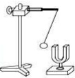

18. （2分）关于如图所示的有关声现象的四个实验，下列说法中正确的是（ ）

甲

乙

丙

丁

A. 甲：用大小不同的力敲击鼓面，观察到纸屑跳动的幅度不同，同时听到鼓声的响度也不同，说明响度跟振幅有关

B. 乙：通过观察乒乓球是否被正在发声的音叉弹起，可以探究声音的传播是否需要介质

C. 丙：玻璃罩内空气抽出时听到铃声逐渐变小，可以推断真空不能传声

D. 丁：用相同大小的力拨动伸出桌面长度不同的锯条，可以探究音调与振幅的关系

> [!question]- 点击查看答案与解析
> 【答案】AC
> 
> 【考点】声音的产生与传播、声音的特性 → [[【初中物理知识点体系-北师大版】#3-1 声音的产生与传播]]
> 
> 【解析】
> - 选项A：甲实验中，用大小不同的力敲击鼓面，纸屑跳动幅度不同，响度也不同，说明响度跟振幅有关，正确；
> - 选项B：乙实验中，通过观察乒乓球是否被音叉弹起，可以探究声音是由振动产生的，而不是探究声音的传播是否需要介质，错误；
> - 选项C：丙实验中，玻璃罩内空气抽出时铃声变小，可以推断真空不能传声，正确；
> - 选项D：丁实验中，用相同大小的力拨动伸出桌面长度不同的锯条，可以探究音调与频率的关系，而不是振幅，错误。
> 
> 【易错点】混淆声音各特性的探究实验。