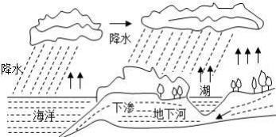

19. （2分）地球表面70%以上是海洋，但可供人类直接利用的淡水资源不足全部水资源的万分之一，提高节水意识是公民的义务和责任。如图是水循环示意图，下列说法正确的是（ ）

A. 地表水吸热，汽化成水蒸气

B. 水蒸气与冷空气接触，液化成小水滴

C. 小水滴遇到更冷的气流，凝华成小冰晶

D. 小冰晶降落过程中，液化成雨水

> [!question]- 点击查看答案与解析
> 【答案】ABC
> 
> 【考点】汽化和液化、熔化和凝固 → [[【初中物理知识点体系-北师大版】#1-3 汽化和液化]]
> 
> 【解析】
> - 选项A：地表水吸热，汽化成水蒸气，正确；
> - 选项B：水蒸气与冷空气接触，液化成小水滴，正确；
> - 选项C：小水滴遇到更冷的气流，凝华成小冰晶，正确；
> - 选项D：小冰晶降落过程中，熔化成雨水，而不是液化，错误。
> 
> 【易错点】混淆水循环中各物态变化的名称。