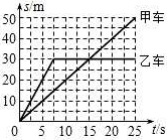

20. （2分）如图是甲、乙两车从同一地点沿同一方向运动的 $s-t$ 图像，由图像可知（ ）

A. $0\sim5\,\mathrm{s}$，甲车的速度比乙车的速度小

B. $0\sim15\,\mathrm{s}$，甲、乙两车平均速度相等

C. 距离出发点 $30\,\mathrm{m}$ 处，甲车追上乙车

D. $10\sim25\,\mathrm{s}$，乙车做匀速直线运动

> [!question]- 点击查看答案与解析
> 【答案】BC
> 
> 【考点】运动的快慢 → [[【初中物理知识点体系-北师大版】#2-3 运动的快慢]]
> 
> 【解析】
> 从s-t图像分析：
> - 选项A：$0\sim5\,\mathrm{s}$，甲车图像斜率大于乙车，甲车速度比乙车大，错误；
> - 选项B：$0\sim15\,\mathrm{s}$，甲、乙两车位移相同，平均速度相等，正确；
> - 选项C：距离出发点 $30\,\mathrm{m}$ 处，甲车追上乙车，正确；
> - 选项D：$10\sim25\,\mathrm{s}$，乙车图像是曲线，不是匀速直线运动，错误。
> 
> 【易错点】不能正确分析s-t图像的物理意义。