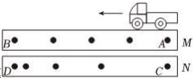

23. （2分）小北利用载有“滴墨装置”（每隔相等时间滴下一滴墨水）的小车在长纸带上运动，研究小车在水平面上的运动快慢。如图所示的M和N纸带分别是小车先后两次运动得到的纸带的一部分。小车在 ___ （选填“M”或“N”）纸带上的运动可能是匀速直线运动。小车在M纸带上从滴痕A运动到滴痕B的平均速度为 $v_{M}$，在N纸带上从滴痕C运动到滴痕D的平均速度为 $v_{N}$，则 $v_{M}$ ___ $v_{N}$（选填“＞”、“＜”或“＝”）。

> [!question]- 点击查看答案与解析
> 【答案】N；$=$
> 
> 【考点】运动的快慢 → [[【初中物理知识点体系-北师大版】#2-3 运动的快慢]]
> 
> 【解析】
> 从纸带分析：
> - M纸带上滴痕间距不均匀，说明速度在变化；
> - N纸带上滴痕间距均匀，说明小车做匀速直线运动；
> - 匀速直线运动的速度不变，所以 $v_M=v_N$。
> 
> 【易错点】不能正确判断匀速直线运动的特点。