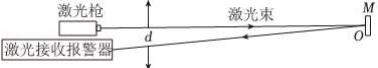

24. （1分）如图所示是一种激光报警装置的布防示意图，激光枪发出的激光束经过平面镜M的O点反射到激光接收报警器，当有人进入警戒区域（如图带阴影的方框内）遮挡了激光束时，报警器就会发出警报。若要扩大警戒区域的宽度d，则要相应 ___ （选填“增大”或“减小”）激光束的入射角。

> [!question]- 点击查看答案与解析
> 【答案】增大
> 
> 【考点】光的反射 → [[【初中物理知识点体系-北师大版】#4-2 光的反射]]
> 
> 【解析】
> 根据光的反射定律，入射角越大，反射角也越大，反射光线偏离入射光线的距离越大。若要扩大警戒区域的宽度d，需要让反射光线覆盖更大的范围，因此要增大入射角。
> 
> 【易错点】不能正确应用光的反射定律。