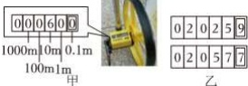

25. （2分）测距轮广泛用于道路、管线建设工程中长度的测量。显示盒上示数为车轮累计滚过的距离，即测距轮的周长 $s\times$ 车轮滚动的总圈数 $n$，如图甲所示。施工人员某次测距前、后显示盒示数如图乙所示，这次测量结果为 ___ ，若车轮磨损，测量结果（选填“偏大”“偏小”或“不变”）。

> [!question]- 点击查看答案与解析
> 【答案】$3.18\,\mathrm{m}$；偏大
> 
> 【考点】长度和时间的测量 → [[【初中物理知识点体系-北师大版】#2-1 长度和时间的测量]]
> 
> 【解析】
> 测距轮显示盒有6位数字，位值分别为 $1000\,\mathrm{m}$、$100\,\mathrm{m}$、$10\,\mathrm{m}$、$1\,\mathrm{m}$、$0.1\,\mathrm{m}$、$0.01\,\mathrm{m}$。
> - 测距前示数：$202.59\,\mathrm{m}$；
> - 测距后示数：$205.77\,\mathrm{m}$；
> - 测量结果 $=205.77-202.59=3.18\,\mathrm{m}$；
> - 若车轮磨损，实际周长变小，走过相同实际距离时转动圈数增多，显示盒累计值偏大，所以测量结果偏大。
> 
> 【易错点】不能正确读取测距轮显示盒的示数；不理解车轮磨损对测量结果的影响方向。