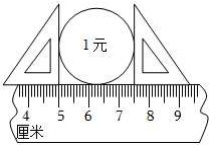

26. （2分）如图所示，硬币的直径是 ___ $\mathrm{cm}$。

> [!question]- 点击查看答案与解析
> 【答案】$1.85$
> 
> 【考点】长度和时间的测量 → [[【初中物理知识点体系-北师大版】#2-1 长度和时间的测量]]
> 
> 【解析】
> 从图中刻度尺可知：
> - 刻度尺的分度值为 $1\,\mathrm{mm}$；
> - 硬币左端对准 $3.00\,\mathrm{cm}$ 处；
> - 右端对准 $4.85\,\mathrm{cm}$ 处；
> - 硬币直径 $=4.85-3.00=1.85\,\mathrm{cm}$。
> 
> 【易错点】刻度尺读数时没有估读到分度值下一位。