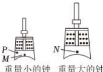

27. （4分）编钟是我国古代重要的打击乐器，如图是两只仿制的重量不同的编钟。在一次展示活动中，工作人员先后敲击P、M和N处，发出乐音的音调逐次降低，用示波器可以测得敲击P处发出声音的频率比敲击N处发出声音的频率 ___ （选填“高”或“低”）， ___ （选填“能”或“不能”）得出“编钟发出声音的频率与编钟的重量大小有关”的结论。

> [!question]- 点击查看答案与解析
> 【答案】高；不能
> 
> 【考点】声音的特性 → [[【初中物理知识点体系-北师大版】#3-2 声音的特性]]
> 
> 【解析】
> - 敲击P处音调最高，敲击N处音调最低，所以P处频率比N处高；
> - 实验中P、M、N是同一只编钟的不同位置，重量相同，不能得出"编钟发出声音的频率与编钟的重量大小有关"的结论。
> 
> 【易错点】混淆音调与响度的影响因素。