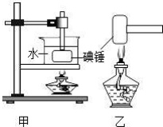

29. （4分）如图甲所示是用“水浴法”加热碘锤，如图乙所示是直接将碘锤放在酒精灯火焰上加热，一段时间后碘锤中充满了紫色的碘蒸气。已知水的沸点是 $100^{\circ}\mathrm{C}$，碘的熔点是 $113.5^{\circ}\mathrm{C}$、沸点是 $184.4^{\circ}\mathrm{C}$，酒精灯外焰温度约为 $400^{\circ}\mathrm{C}$。为了观察碘的升华，选用 ___ 图实验方案更加合理。请简述不选用另一种方案的理由： ___ 。

> [!question]- 点击查看答案与解析
> 【答案】甲；直接加热温度超过碘的熔点，碘会先熔化再汽化，无法观察到升华现象
> 
> 【考点】升华和凝华 → [[【初中物理知识点体系-北师大版】#1-4 升华和凝华]]
> 
> 【解析】
> - 水的沸点为 $100^{\circ}\mathrm{C}$，低于碘的熔点 $113.5^{\circ}\mathrm{C}$；
> - 水浴法加热时，温度最高为 $100^{\circ}\mathrm{C}$，低于碘的熔点，碘不会熔化；
> - 酒精灯外焰温度约 $400^{\circ}\mathrm{C}$，远高于碘的熔点，直接加热碘会先熔化；
> - 所以选用水浴法（甲图）更合理，可以直接观察到碘从固态变为气态的升华现象。
> 
> 【易错点】混淆升华与熔化的条件。