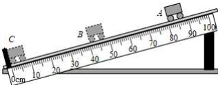

30. （5分）小楠同学用如图所示的装置测量小车运动的平均速度，实验时让小车从斜面的A点由静止下滑并开始计时。

（1）本实验的测量原理是 ___ （公式）。

（2）测量前该同学先让斜面保持一个较小的角度，让小车从A点由静止下滑，发现小车略微滑动了一下就停住了，接下来应该将斜面的倾角稍微调 ___ （选填“大”或“小”）一些，使小车能够运动到斜面底端。

（3）调整好装置后进行测量，测得小车从A点由静止下滑到C点所用时间 $t_{AC}=5\,\mathrm{s}$，根据图中信息，小车在AC段的平均速度 $v_{AC}=$ ___ $\mathrm{cm/s}$。

（4）为了测量小车运动过程中后半程BC段的平均速度，再次将小车从A点由静止下滑，测得小车从A点下滑到B点所用时间 $t_{AB}=3\,\mathrm{s}$，由此可知后半程BC段的平均速度 $v_{BC}$ ___ $v_{AC}$（选填“>”、“<”或“=”）。

（5）在测量小车AC段运动的时间时，如果小车过了A点才开始计时，则会使测得的AC段的平均速度偏 ___ 。

> [!question]- 点击查看答案与解析
> 【答案】（1）$v=\frac{s}{t}$；（2）大；（3）$16$；（4）$>$；（5）小
> 
> 【考点】平均速度的测量 → [[【初中物理知识点体系-北师大版】#2-4 平均速度的测量]]
> 
> 【解析】
> （1）测量平均速度的原理是 $v=\frac{s}{t}$；
> 
> （2）小车不能滑动，说明斜面倾角太小，摩擦力太大，应该将倾角调大一些；
> 
> （3）从图中可知，AC段距离 $s=80.0\,\mathrm{cm}$，时间 $t=5\,\mathrm{s}$，$v_{AC}=\frac{80.0}{5}=16\,\mathrm{cm/s}$；
> 
> （4）小车做加速运动，后半程速度大于全程平均速度，所以 $v_{BC}>v_{AC}$；
> 
> （5）过了A点才开始计时，测得时间偏小，根据 $v=\frac{s}{t}$，平均速度偏大。
> 
> 【易错点】平均速度测量实验中误差分析错误。