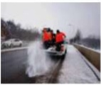
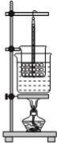
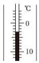
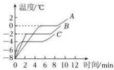

31. （5分）如图甲所示，大雪过后路面结冰，环卫工人会在路面上撒粗盐，确保了行人和车辆的出行安全。为了弄清其中缘由，小张做了一组含盐量不同的冰的熔化实验。

甲

乙

丙

丁

（1）如图乙，在组装实验器材时，应按照 ___ （选填“自下而上”或“自上而下”）的顺序组装。实验中某时刻温度计的示数如图丙所示，示数是 ___ $^{\circ}\mathrm{C}$。

（2）实验时在试管里装有适量的 ___ （选填“冰块”或“碎冰”），加热一段时间后，小张根据记录的实验数据在丁图中绘制了A图像，冰的熔点是 ___ $^{\circ}\mathrm{C}$。

（3）完成上述实验后，小张又取了适量淡盐水制成的冰，用相同的热源再次加热，得到丁图中B图像；再次取适量浓盐水制成的冰，用相同的热源加热，得到丁图中C图像。由实验得到的图像可知，加入盐后冰的熔点将会 ___ （选填“升高”、“降低”或“不变”）。

> [!question]- 点击查看答案与解析
> 【答案】（1）自下而上；$-2$；（2）碎冰；$0$；（3）降低
> 
> 【考点】熔化和凝固 → [[【初中物理知识点体系-北师大版】#1-2 熔化和凝固]]
> 
> 【解析】
> （1）组装实验器材应按照自下而上的顺序；温度计示数在零下，分度值为 $1^{\circ}\mathrm{C}$，示数为 $-2^{\circ}\mathrm{C}$；
> 
> （2）实验时应选用碎冰，受热更均匀；从图像A可知，冰的熔点是 $0^{\circ}\mathrm{C}$；
> 
> （3）从图像可知，加入盐后冰的熔点降低。
> 
> 【易错点】混淆晶体与非晶体的熔化图像。