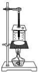
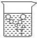
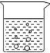
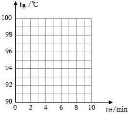

32. （6分）小听看到妈妈为她炖汤时先用大火加热，待汤沸腾后会将火调小，既保持锅内汤沸腾又能节约燃料。小听提出了一个疑问：“水沸腾后的温度跟加热的火的大小有没有关系呢？”为此小听用如图甲所示的装置加热水，并每隔 $1\,\mathrm{min}$ 测量一次水的温度。

甲

乙

丙

丁

（1）小听在加热 $5\,\mathrm{min}$ 后观察到如图 ___ （选填“乙”或“丙”）所示的现象，说明此时水达到了沸腾状态。

（2）请根据下面小听实验中记录的数据在坐标图中描点，发现规律并连线绘制图像。

| $t/\mathrm{min}$ | 0 | 1 | 2 | 3 | 4 | 5 | 6 | 7 | 8 |
|------|------|------|------|------|------|------|------|------|------|
| $t_{\text{温}}/^{\circ}\mathrm{C}$ | 90 | 92 | 94 | 96 | 98 | 99 | 99 | 99 | 99 |

（3）从数据和图像可知，水的沸点为 ___ $^{\circ}\mathrm{C}$，水沸腾时继续加热，水的温度 ___ 。

（4）为了寻找证据，解答自己的疑问，小听还需要进行怎样的实验操作？请简述实验步骤（可以添加实验室常见的器材）： ___ 。

> [!question]- 点击查看答案与解析
> 【答案】（1）丙；（2）图像见解析；（3）$99$；不变；（4）见解析
> 
> 【考点】汽化和液化 → [[【初中物理知识点体系-北师大版】#1-3 汽化和液化]]
> 
> 【解析】
> （1）水沸腾时气泡由下往上逐渐变大，图丙符合；
> 
> （2）根据数据描点连线，得到温度随时间变化的图像；
> 
> （3）从数据可知，水的沸点为 $99^{\circ}\mathrm{C}$，水沸腾时继续加热，温度不变；
> 
> （4）为了探究水沸腾后的温度与火的大小的关系，应该在水沸腾后，分别用大火和小火加热，测量水的温度进行比较。
> 
> 【易错点】不能正确分析水沸腾实验的数据和图像。