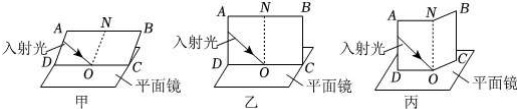

33. （4分）小明利用激光笔、平面镜和纸板做探究光的反射规律的实验。纸板ABCD是用两块纸板ADON和BCON连接起来的。他将一个平面镜放在水平桌面上，把纸板ABCD展开成一个平面。

（1）把纸板ABCD倾斜的立在平面镜上，如图甲所示，使一束光贴着纸板ADON沿某一个角度射到O点，经平面镜反射，在纸板NBCO上 ___ （选填“能”或“不能”）看到反射光。

（2）把纸板ABCD竖直的立在平面镜上，如图乙所示，纸板上的直线ON垂直于平面镜，使一束光贴着纸板ADON沿某一个角度射到O点，经平面镜反射，在纸板NBCO上 ___ （选填“能”或“不能”）看到反射光。

（3）把纸板NBCO向后折，纸板上的直线ON仍垂直于平面镜，如图丙所示，使一束光贴着纸板ADON沿某一个角度射到O点，经平面镜反射，在纸板NBCO上 ___ （选填“能”或“不能”）看到反射光。

（4）由上述实验可得出结论： ___ 。

> [!question]- 点击查看答案与解析
> 【答案】（1）不能；（2）能；（3）不能；（4）反射光线、入射光线和法线在同一平面内
> 
> 【考点】光的反射 → [[【初中物理知识点体系-北师大版】#4-2 光的反射]]
> 
> 【解析】
> （1）纸板倾斜时，反射光线不在纸板平面上，不能看到反射光；
> 
> （2）纸板竖直且ON垂直于镜面时，反射光线在纸板平面上，能看到反射光；
> 
> （3）把纸板NBCO向后折，反射光线不在纸板平面上，不能看到反射光；
> 
> （4）实验结论：反射光线、入射光线和法线在同一平面内。
> 
> 【易错点】混淆光的反射定律中各要素的关系。