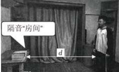

34. （2分）北京四中开展了制作隔音房间模型跨学科实践活动，小元同学在项目实施过程中选择鞋盒充当隔音“房间”，放入闹钟作为噪声源，选用海绵、石膏板、隔音窗帘布、棉花四种隔音材料。在测试厚度均为2cm的四种隔音材料隔音效果的过程中，由于没有专业的分贝测试仪，如图所示，他逐渐远离“房间”，直到听不见“房间”内传出的铃声，用米尺测量人离“房间”的距离d并记录在数据表格中。

（1）请完成数据表格中表头的填写：

| 材料种类 | 无 | 海绵 | 石膏板 | 隔音窗帘布 | 棉花 |
|------|------|------|------|------|------|
| — | 4.2 | 3 | 2.8 | 3.4 | 3.8 |

（2）分析表格中数据可知 ___ 材料的隔音效果最好。

> [!question]- 点击查看答案与解析
> 【答案】（1）人离"房间"的距离 $d/\mathrm{m}$；（2）石膏板
> 
> 【考点】噪声的危害和控制 → [[【初中物理知识点体系-北师大版】#3-4 噪声的危害和控制]]
> 
> 【解析】
> （1）表格中应填写"人离'房间'的距离 $d/\mathrm{m}$"；
> 
> （2）从数据可知，石膏板对应的距离最小（$2.8\,\mathrm{m}$），说明隔音效果最好。
> 
> 【易错点】不能正确分析实验数据得出结论。