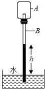

35. （4分）科学兴趣小组的同学自制了如图所示的测温装置“伽利略温度计”。图中A为一只小塑料瓶，B为一根透明玻璃管并通过密封橡皮塞与A相连，管的下端竖直插在烧杯内的水中，使管内外水面有高度差 $h$，然后进行实验探究：改变装置所处的环境温度 $t$，分别测出不同温度下所对应的水柱高度 $h$，记录的实验数据如表所示。

| 温度 $t/^{\circ}\mathrm{C}$ | 17   | 19  | 21   | 23  | 25  | 27  | 28  |
| ------------------------- | ---- | --- | ---- | --- | --- | --- | --- |
| 水柱高度 $h/\mathrm{cm}$      | 30.2 | 25. | 19.8 |     | 9.4 | 4.2 | 1.6 |

（1）装置中的 ___ （选填“小塑料瓶”或“烧杯”）相当于实验室中使用的液体温度计的玻璃泡。

（2）根据表中的数据可推出：当温度为 $23^{\circ}\mathrm{C}$ 时，水柱高度 $h$ 为 ___ $\mathrm{cm}$。

（3）要提高“伽利略温度计”的精确度，对该装置可以怎样改进？ ___ 。（写出一点即可）

> [!question]- 点击查看答案与解析
> 【答案】（1）小塑料瓶；（2）$14.6$；（3）见解析
> 
> 【考点】温度及其测量 → [[【初中物理知识点体系-北师大版】#1-1 温度及其测量]]
> 
> 【解析】
> （1）小塑料瓶A相当于温度计的玻璃泡，内部气体受热膨胀；
> 
> （2）根据数据，温度每升高 $2^{\circ}\mathrm{C}$，水柱高度下降约 $5\,\mathrm{cm}$，所以 $23^{\circ}\mathrm{C}$ 时水柱高度约为 $14.6\,\mathrm{cm}$；
> 
> （3）可以使用更细的玻璃管，使水柱高度变化更明显，提高精确度。
> 
> 【易错点】不能正确理解伽利略温度计的工作原理。