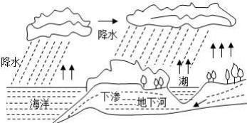
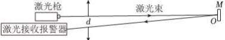
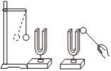

## 试卷地址：https://www.jyeoo.com/physics/report/detail/7pdGIdGJ0RHMdgNkn8sGXkdNKPQdrV0odG6MlGmsBZea2MA152yP3I

## 一、单项选择题（下列各小题均有四个选项，其中只有一个选项符合题意。共30分，每小题2分）

1. （2分）如图所示的四个情景中，属于光的反射现象的是（ ）

A. 树荫下的圆形光斑

B. 日食的形成

C. 林中树的影子

D. 水面波光粼粼

2. （2分）唐代诗人刘禹锡《秋词二首》中有“山明水净夜来霜，数树深红出浅黄”的诗句，其所说的“霜”形成过程的物态变化属于（ ）

A. 凝固

B. 凝华

C. 熔化

D. 液化

3. （2分）噪声是一种环境污染，对人的危害也很大。下列减弱噪声的措施中属于阻断噪声传播的是（ ）

A. 高速公路两旁安装隔音墙

B. 在公园内安装噪声检测装置

C. 禁止机动车在学校附近鸣笛

D. 机场的地勤人员戴耳罩工作

4. （2分）声音不仅是我们获取信息的重要手段，声音还具有传递能量的特点，下列事例中属于利用声传递能量的是（ ）

A. 用超声波清洗眼镜和首饰

B. 听到隆隆的雷声预示着可能要下雨

C. 医生用听诊器为病人检查肺部是否有炎症

D. 用超声探伤仪检测大型金属零件内部是否有裂纹

5. （2分）如图所示的4D电影是在3D影片的基础上增加了运动座椅，随着影片的播放，观众跟随座椅一起扭转晃荡，大大增加了观众的观影融入感。如果忽略观众在座椅上的肢体动作，关于4D电影以下说法正确的是（ ）

A. 以座椅为参照物，地面是静止的

B. 以人为参照物，座椅是运动的

C. 以地面为参照物，人是静止的

D. 以座椅为参照物，人是静止的

6. （2分）小北特别喜欢学习物理，读到四大名著的一些场面时，总是不自觉的跟物理关联起来，下列说法正确的是（ ）

A. 《三国演义》中描写打仗时，士兵用力擂鼓，声音传的很远，是因为声音的音调高

B. 《西游记》中孙悟空在水中求东海龙王，说：“帮我下场雨，救救我师父”，说明水能够传声

C. 《红楼梦》中林黛玉进贾府时，大家仅靠听笑声就判断出来人是王熙凤，利用了声音的音调不同

D. 《水浒传》中“铁笛仙”马麟，吹笛子时发出声音，靠的是笛子的振动

7. （2分）如图甲，用金属镓制成的“小人”在室温为 $20^{\circ}\mathrm{C}$ 时是固态，当其达到某一温度时，就会发生熔化。图乙是其放在人手中熔化时的情景，由此可判断（ ）

甲

乙

A. 镓是非晶体

B. 镓的熔点可能是 $29^{\circ}\mathrm{C}$

C. 可用镓制成的锅烧开水

D. 镓熔化的过程中，放出热量

8. （2分）如图所示是某型号小汽车的车轮及其规格型号尺寸数据“195/55R 5……”，其中“15”表示轮毂直径为15英寸，车轮的断面宽“195”的单位应当是（ ）

A. $m$

B. $dm$

C. $cm$

D. $mm$

9. （2分）如图所示声波的波形图，下列说法正确的是（ ）

A. 甲、乙的音色相同

B. 甲、丙的音调相同

C. 乙、丙的响度相同

D. 丙、丁的音调和响度都相同

10. （2分）我国“祝融号”火星车顶部安装有集热窗，里面填装有熔点为 $-26^{\circ}\mathrm{C}$、沸点为 $196^{\circ}\mathrm{C}$ 的正十一烷材料，该材料有助于火星车适应火星白天 $-3^{\circ}\mathrm{C}$ 至夜晚 $-103^{\circ}\mathrm{C}$ 的温度变化。关于正十一烷材料下列分析正确的是（ ）

A. 正十一烷材料熔化时，温度一定升高

B. 当火星上的清晨来临时，正十一烷会迅速液化

C. 正十一烷材料在火星上的白天一定处于固态

D. 利用正十一烷凝固放热，“祝融号”可以抵御火星夜间低温

11. （2分）古时候通常会用“一炷香”作为计时单位，一炷质地均匀的香匀速燃烧完毕的时间通常约半个时辰，即1小时。如图甲是一炷长为 $t$ 刚点燃的香，如图乙是此炷香燃烧一段时间后的剩余部分。则图乙中的香燃尽还需要的时间最接近（ ）

A. $1800\,\mathrm{s}$

B. $1200\,\mathrm{s}$

C. $600\,\mathrm{s}$

D. $300\,\mathrm{s}$

12. （2分）小海爸爸在散步后看到自己手机上运动app显示的部分信息如图所示。下列说法错误的是（ ）

A. 小海爸爸本次散步时的平均速度为 $4\,\mathrm{km/h}$

B. 小海爸爸本次散步时平均一步的距离约 $0.6\,\mathrm{m}$

C. 小海爸爸本次散步到 $2\,\mathrm{km}$ 时一定用时 $30\,\mathrm{min}$

D. “平均配速”的数值越小表示运动越快

13. （2分）蒸馏法在酿酒过程中得到广泛应用，如图所示为蒸馏过程中的原理图，烧瓶内装有含酒精和水的酒糟，酒糟经过该装置后变为酒精含量更高的白酒，已知一标准大气压下，酒精沸点比水低。在蒸馏过程中，下列说法正确的是（ ）

A. 在烧瓶内，酒精沸腾，瓶中的酒精升华需要吸热

B. 在烧瓶内，仅酒精沸腾，瓶中的水不会发生汽化

C. 在冷凝器处，管内酒精蒸汽遇冷液化，需要放热

D. 在冷凝器处，管外的冷却水对管内的酒精蒸汽放热

14. （2分）周末，小华在家中烧开水煮饺子。当水烧开准备下饺子时，妈妈提醒她锅里的水量太少了，于是，小华又往锅里迅速加了一大碗冷水（水量比锅里的少）。下面最能大致反映整个烧水过程中水温随着时间变化的图象是（ ）

A.

B.

C.

D.

15. （2分）探测队利用声呐测绘某江域水底的形状，探测队驾驶船只经过该江城水平面的A、B、C三个位置时，向水底定向发射超声波，仪器记录从发出声音到接收到回声的时间 $t$ 如表所示。由此推测A、B、C三个位置下水底的大致形状是（ ）

| 采样位置 | A | B | C |
|------|------|------|------|
| 时间 $t/s$ | 0.30 | 0.16 | 0.30 |

A.

B.

C.

D.

## 二、多项选择题（下列每题均有四个选项，其中符合题意的选项均多于一个。共10分，每题2分。每题选项全选对的得2分，选对但不全的得1分，有错选的不得分）

16. （2分）下列措施中，为了减慢蒸发的是（ ）

A. 酒精灯不用时盖上灯帽

B. 春季植树时剪除大量枝叶

C. 用保鲜袋蔬菜放入冰箱

D. 将湿衣服展开后晾在向阳、通风处

17. （2分）小广在物理课上学习了多种测量物体长度的方法。为了测量一角硬币的厚度，小广的下列做法中可行的是（ ）

A. 用分度值为 $1\,\mathrm{dm}$ 的刻度尺直接测量

B. 为了减小了测量误差，多次测量硬币的厚度求平均值

C. 如果刻度尺的零刻线磨损了，就使用刻度尺的中间部分来测量

D. 测出n枚硬币的总厚度L，再除以总个数n，就是一枚硬币的厚度

18. （2分）关于如图所示的有关声现象的四个实验，下列说法中正确的是（ ）

甲

乙

丙

丁

A. 甲：用大小不同的力敲击鼓面，观察到纸屑跳动的幅度不同，同时听到鼓声的响度也不同，说明响度跟振幅有关

B. 乙：通过观察乒乓球是否被正在发声的音叉弹起，可以探究声音的传播是否需要介质

C. 丙：玻璃罩内空气抽出时听到铃声逐渐变小，可以推断真空不能传声

D. 丁：用相同大小的力拨动伸出桌面长度不同的锯条，可以探究音调与振幅的关系

19. （2分）地球表面70%以上是海洋，但可供人类直接利用的淡水资源不足全部水资源的万分之一，提高节水意识是公民的义务和责任。如图是水循环示意图，下列说法正确的是（ ）

A. 地表水吸热，汽化成水蒸气

B. 水蒸气与冷空气接触，液化成小水滴

C. 小水滴遇到更冷的气流，凝华成小冰晶

D. 小冰晶降落过程中，液化成雨水

20. （2分）如图是甲、乙两车从同一地点沿同一方向运动的 $s-t$ 图像，由图像可知（ ）

A. $0\sim5\,\mathrm{s}$，甲车的速度比乙车的速度小

B. $0\sim15\,\mathrm{s}$，甲、乙两车平均速度相等

C. 距离出发点 $30\,\mathrm{m}$ 处，甲车追上乙车

D. $10\sim25\,\mathrm{s}$，乙车做匀速直线运动

## 三、填空题（共8分，每空1分）

21. （2分）完成下列单位换算：

（1）在高速公路上行驶的汽车速度 $108\mathrm{km/h}=$ ___ $\mathrm{m/s}$；

（2）初中生小明的身高 $175\mathrm{cm}=$ ___ $\mathrm{m}$。

22. （1分）小明周末和妈妈一起观看了非遗文化“打铁花”表演后，经过查找资料得知“打铁花”主要过程是将生铁烧至 $1600^{\circ}\mathrm{C}$ 以上化成铁水，一名表演者舀起铁水抛向空中，另一名表演者用力击打空中铁水，瞬间朵朵“铁花”绽放，如图所示。飞溅的铁水变成铁屑掉落地面的过程会 ___ （选填“吸收”或“放出”）热量。

23. （2分）小北利用载有“滴墨装置”（每隔相等时间滴下一滴墨水）的小车在长纸带上运动，研究小车在水平面上的运动快慢。如图所示的M和N纸带分别是小车先后两次运动得到的纸带的一部分。小车在 ___ （选填“M”或“N”）纸带上的运动可能是匀速直线运动。小车在M纸带上从滴痕A运动到滴痕B的平均速度为 $v_{M}$，在N纸带上从滴痕C运动到滴痕D的平均速度为 $v_{N}$，则 $v_{M}$ ___ $v_{N}$（选填“＞”、“＜”或“＝”）。

24. （1分）如图所示是一种激光报警装置的布防示意图，激光枪发出的激光束经过平面镜M的O点反射到激光接收报警器，当有人进入警戒区域（如图带阴影的方框内）遮挡了激光束时，报警器就会发出警报。若要扩大警戒区域的宽度d，则要相应 ___ （选填“增大”或“减小”）激光束的入射角。

25. （2分）测距轮广泛用于道路、管线建设工程中长度的测量。显示盒上示数为车轮累计滚过的距离，即测距轮的周长 $s\times$ 车轮滚动的总圈数 $n$，如图甲所示。施工人员某次测距前、后显示盒示数如图乙所示，这次测量结果为 ___ ，若车轮磨损，测量结果（选填“偏大”“偏小”或“不变”）。

## 四、实验探究题（共42分，26题～29题、32（4）题、35（3）题每空2分，其余题每空、每图1分）

26. （2分）如图所示，硬币的直径是 ___ $\mathrm{cm}$。

27. （4分）编钟是我国古代重要的打击乐器，如图是两只仿制的重量不同的编钟。在一次展示活动中，工作人员先后敲击P、M和N处，发出乐音的音调逐次降低，用示波器可以测得敲击P处发出声音的频率比敲击N处发出声音的频率 ___ （选填“高”或“低”）， ___ （选填“能”或“不能”）得出“编钟发出声音的频率与编钟的重量大小有关”的结论。

28. （6分）如图所示的实验中，两只音叉完全相同，左边的音叉与悬挂的乒乓球贴紧。当敲击右边的音叉，可以看到乒乓球弹起。乒乓球弹起可说明左边的音叉在 ___ ，该实验还可以说明声音可以传递 ___ （选填“信息”或“能量”），如果在没有大气层的月球表面进行该实验， ___ （选填“能”或“不能”）看到乒乓球弹起的现象。

29. （4分）如图甲所示是用“水浴法”加热碘锤，如图乙所示是直接将碘锤放在酒精灯火焰上加热，一段时间后碘锤中充满了紫色的碘蒸气。已知水的沸点是 $100^{\circ}\mathrm{C}$，碘的熔点是 $113.5^{\circ}\mathrm{C}$、沸点是 $184.4^{\circ}\mathrm{C}$，酒精灯外焰温度约为 $400^{\circ}\mathrm{C}$。为了观察碘的升华，选用 ___ 图实验方案更加合理。请简述不选用另一种方案的理由： ___ 。

30. （5分）小楠同学用如图所示的装置测量小车运动的平均速度，实验时让小车从斜面的A点由静止下滑并开始计时。

（1）本实验的测量原理是 ___ （公式）。

（2）测量前该同学先让斜面保持一个较小的角度，让小车从A点由静止下滑，发现小车略微滑动了一下就停住了，接下来应该将斜面的倾角稍微调 ___ （选填“大”或“小”）一些，使小车能够运动到斜面底端。

（3）调整好装置后进行测量，测得小车从A点由静止下滑到C点所用时间 $t_{AC}=5\,\mathrm{s}$，根据图中信息，小车在AC段的平均速度 $v_{AC}=$ ___ $\mathrm{cm/s}$。

（4）为了测量小车运动过程中后半程BC段的平均速度，再次将小车从A点由静止下滑，测得小车从A点下滑到B点所用时间 $t_{AB}=3\,\mathrm{s}$，由此可知后半程BC段的平均速度 $v_{BC}$ ___ $v_{AC}$（选填“>”、“<”或“=”）。

（5）在测量小车AC段运动的时间时，如果小车过了A点才开始计时，则会使测得的AC段的平均速度偏 ___ 。

31. （5分）如图甲所示，大雪过后路面结冰，环卫工人会在路面上撒粗盐，确保了行人和车辆的出行安全。为了弄清其中缘由，小张做了一组含盐量不同的冰的熔化实验。

甲
 

乙
 

丙
 

丁
 

（1）如图乙，在组装实验器材时，应按照 ___ （选填“自下而上”或“自上而下”）的顺序组装。实验中某时刻温度计的示数如图丙所示，示数是 ___ $^{\circ}\mathrm{C}$。

（2）实验时在试管里装有适量的 ___ （选填“冰块”或“碎冰”），加热一段时间后，小张根据记录的实验数据在丁图中绘制了A图像，冰的熔点是 ___ $^{\circ}\mathrm{C}$。

（3）完成上述实验后，小张又取了适量淡盐水制成的冰，用相同的热源再次加热，得到丁图中B图像；再次取适量浓盐水制成的冰，用相同的热源加热，得到丁图中C图像。由实验得到的图像可知，加入盐后冰的熔点将会 ___ （选填“升高”、“降低”或“不变”）。

32. （6分）小听看到妈妈为她炖汤时先用大火加热，待汤沸腾后会将火调小，既保持锅内汤沸腾又能节约燃料。小听提出了一个疑问：“水沸腾后的温度跟加热的火的大小有没有关系呢？”为此小听用如图甲所示的装置加热水，并每隔 $1\,\mathrm{min}$ 测量一次水的温度。

甲

乙

丙

丁

（1）小听在加热 $5\,\mathrm{min}$ 后观察到如图 ___ （选填“乙”或“丙”）所示的现象，说明此时水达到了沸腾状态。

（2）请根据下面小听实验中记录的数据在坐标图中描点，发现规律并连线绘制图像。

| $t/\mathrm{min}$ | 0 | 1 | 2 | 3 | 4 | 5 | 6 | 7 | 8 |
|------|------|------|------|------|------|------|------|------|------|
| $t_{\text{温}}/^{\circ}\mathrm{C}$ | 90 | 92 | 94 | 96 | 98 | 99 | 99 | 99 | 99 |

（3）从数据和图像可知，水的沸点为 ___ $^{\circ}\mathrm{C}$，水沸腾时继续加热，水的温度 ___ 。

（4）为了寻找证据，解答自己的疑问，小听还需要进行怎样的实验操作？请简述实验步骤（可以添加实验室常见的器材）： ___ 。

33. （4分）小明利用激光笔、平面镜和纸板做探究光的反射规律的实验。纸板ABCD是用两块纸板ADON和BCON连接起来的。他将一个平面镜放在水平桌面上，把纸板ABCD展开成一个平面。

（1）把纸板ABCD倾斜的立在平面镜上，如图甲所示，使一束光贴着纸板ADON沿某一个角度射到O点，经平面镜反射，在纸板NBCO上 ___ （选填“能”或“不能”）看到反射光。

（2）把纸板ABCD竖直的立在平面镜上，如图乙所示，纸板上的直线ON垂直于平面镜，使一束光贴着纸板ADON沿某一个角度射到O点，经平面镜反射，在纸板NBCO上 ___ （选填“能”或“不能”）看到反射光。

（3）把纸板NBCO向后折，纸板上的直线ON仍垂直于平面镜，如图丙所示，使一束光贴着纸板ADON沿某一个角度射到O点，经平面镜反射，在纸板NBCO上 ___ （选填“能”或“不能”）看到反射光。

（4）由上述实验可得出结论： ___ 。

34. （2分）北京四中开展了制作隔音房间模型跨学科实践活动，小元同学在项目实施过程中选择鞋盒充当隔音“房间”，放入闹钟作为噪声源，选用海绵、石膏板、隔音窗帘布、棉花四种隔音材料。在测试厚度均为2cm的四种隔音材料隔音效果的过程中，由于没有专业的分贝测试仪，如图所示，他逐渐远离“房间”，直到听不见“房间”内传出的铃声，用米尺测量人离“房间”的距离d并记录在数据表格中。

（1）请完成数据表格中表头的填写：

| 材料种类 | 无 | 海绵 | 石膏板 | 隔音窗帘布 | 棉花 |
|------|------|------|------|------|------|
| — | 4.2 | 3 | 2.8 | 3.4 | 3.8 |

（2）分析表格中数据可知 ___ 材料的隔音效果最好。

35. （4分）科学兴趣小组的同学自制了如图所示的测温装置“伽利略温度计”。图中A为一只小塑料瓶，B为一根透明玻璃管并通过密封橡皮塞与A相连，管的下端竖直插在烧杯内的水中，使管内外水面有高度差 $h$，然后进行实验探究：改变装置所处的环境温度 $t$，分别测出不同温度下所对应的水柱高度 $h$，记录的实验数据如表所示。

| 温度 $t/^{\circ}\mathrm{C}$ | 17   | 19  | 21   | 23  | 25  | 27  | 28  |
| ------------------------- | ---- | --- | ---- | --- | --- | --- | --- |
| 水柱高度 $h/\mathrm{cm}$      | 30.2 | 25. | 19.8 |     | 9.4 | 4.2 | 1.6 |

（1）装置中的 ___ （选填“小塑料瓶”或“烧杯”）相当于实验室中使用的液体温度计的玻璃泡。

（2）根据表中的数据可推出：当温度为 $23^{\circ}\mathrm{C}$ 时，水柱高度 $h$ 为 ___ $\mathrm{cm}$。

（3）要提高“伽利略温度计”的精确度，对该装置可以怎样改进？ ___ 。（写出一点即可）

## 五、科普阅读题（共4分）

36. （4分）请阅读《风寒温度》回答问题。

风寒温度

秋冬时节当你走在街上，感觉冷暖适宜，突然起了一阵大风，顿时你会觉得周身寒冷，这就是风寒效应。风寒效应会影响人体对冷的感觉，人体感觉的温度与温度计的示数有明显的差别，体感温度与人体散热的速度有关。

人体的主要散热部位是皮肤，通过皮肤的红外辐射、接触传导热量、冷热空气对流和汗液蒸发等方式散热。其中冷热空气对流和蒸发方式的散热速度，主要取决于风速大小。当无风时，在人体皮肤和周围空气之间有一个比较稳定的空气层，由于空气是热的不良导体，可以起到保温作用；当刮风时，稳定的空气保温层不断被新来的冷空气所代替，加快了热量对流和蒸发散热。风速越大，人体散热越快，人也就感觉越寒冷。

科学家提出用风寒温度描述刮风时人体皮肤感觉的温度，并通过大量实验找出了风寒温度和风速的关系。下表是气温为 $5^{\circ}\mathrm{C}$ 时，风寒温度和风速的关系：

| 风速 $v/\mathrm{km}\cdot h^{-1}$ | 0 | 10 | 15 | 20 | 30 | 40 |
|------|------|------|------|------|------|------|
| 风寒温度 $t/^{\circ}\mathrm{C}$ | 5 | 3 | 2 | 1 | -1 | -3 |

另外，在相同风速时，环境温度越低、空气湿度越大，还会进一步降低风寒温度。冬季，出门前我们除了要关注气温外，还应该综合考虑风速和温度，选择合适面料、合适厚度的衣物做好科学防寒。

请根据上述材料，回答下列问题：

（1）人体通过皮肤散热的方式有哪些？请列举一种： ___ 。

（2）用扇子对一只干燥的温度计扇风，温度计的示数不会降低；而用扇子对一只蘸水的温度计扇风，温度计的示数会降低，说明风会加快 ___ （选填“热量对流”或“蒸发散热”），降低了风寒温度。

（3）在气温为 $3^{\circ}\mathrm{C}$、风寒温度为 $2^{\circ}\mathrm{C}$ 时，请你推测风速的大小： ___ 。

A. $15\mathrm{km/h}$

B. 可能为 $10\,\mathrm{km/h}$

C. $0$

（4）冬季户外活动做好科学防寒，请你提出一条合理的建议？ ___ 。

## 六、计算题（共6分，每题3分）

37. （3分）如图所示是我国某地的跨海大桥，大桥全长约 $1200\,\mathrm{m}$，一列车以 $40\,\mathrm{m/s}$ 的速度匀速行驶，列车完全通过大桥需要 $35\,\mathrm{s}$。求：

（1）在 $35\,\mathrm{s}$ 时间内该列车行驶的距离 $s$。

（2）该列车的长度 $L$。

38. （3分）某司机驾车前行，突然发现前方有障碍物。司机从发现险情到踩刹车制动需要的反应时间为 $0.6\,\mathrm{s}$，这段时间内汽车保持速度前行了 $18\,\mathrm{m}$。汽车制动后继续向前滑行了 $40\,\mathrm{m}$ 才停下。

（1）求汽车制动前的行驶速度 $v_{0}$。

（2）若司机酒后驾车，反应时间会达到平时的4倍。请通过计算判断汽车是否会撞上距离 $100\,\mathrm{m}$ 远的障碍物。
