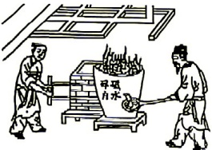

6. 我国古代科技著作《天工开物》里记载了铸造“万钧钟”和“鼎”的方法，先用泥土制作“模骨”，“干燥之后以牛油、黄蜡附其上数寸”，在油蜡上刻上各种图案，然后在油蜡的外面用泥土制成外壳；干燥之后，“外施火力炙化其中油蜡”，油蜡流出形成空腔，在空腔中倒入铜液，待铜液冷却后，“钟鼎成矣”。下列说法正确的是 ( )

A. “炙化其中油蜡”是熔化过程，需要放热

B. “炙化其中油蜡”是液化过程，需要吸热

C. 铜液冷却成钟鼎是凝固过程，需要放热

D. 铜变成铜液是凝固过程，需要吸热

> [!question]- 点击查看答案与解析
> 【答案】C
> 
> 【考点】熔化与凝固及其吸放热 → [[【初中物理知识点体系-北师大版】#1-2 熔化和凝固]]
> 
> 【解析】
> “炙化其中油蜡”是固态油蜡受热变成液态，属于熔化过程，熔化需要吸热。
> - 选项A：判断为熔化正确，但“需要放热”错误；
> - 选项B：把熔化误判为液化，且液化应放热，错误；
> - 选项C：铜液冷却变成固态钟鼎，属于凝固过程，凝固放热，正确；
> - 选项D：铜变成铜液是熔化，不是凝固，且熔化吸热，错误。
> 
> 【易错点】“炙化”即加热熔化，不是液化；注意熔化吸热、凝固放热的对应关系，不要只判断物态变化名称而忽略吸放热。
